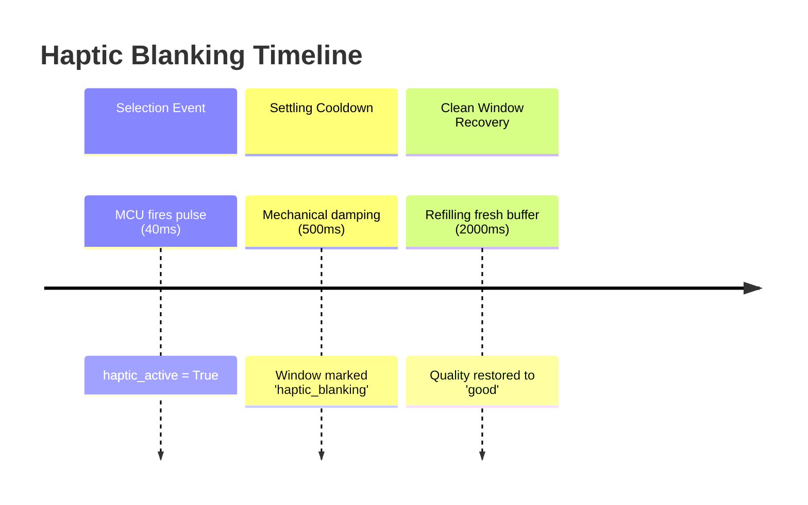

# Haptic Artifact Handling Plan (`analysis/plans/haptic-artifact-handling.md`)

**Owner:** Person 4 (Dedeepya)  
**Status:** Planned / Architecture Phase  

---

## 1. Purpose and Ownership

When an optional vibration motor fires to confirm a selection, the mechanical shock couples directly into the accelerometer mounted on the mouse. If unmanaged, this vibration will be detected as intense hand tremor, creating a catastrophic feedback loop:
$$\text{Selection Cue} \longrightarrow \text{Motor Vibration} \longrightarrow \text{False Tremor Detection} \longrightarrow \text{More Assistance/Haptics}$$
This module flags actuator activity and enforces blanking intervals until the physical sensor settles.

---

## 2. Mechanical Artifact Characteristics

- **Actuator Pulse Duration:** $40\text{–}80\text{ ms}$.
- **Induced Acceleration:** High-amplitude oscillations ($>0.5\text{ g}$ to $>2.0\text{ g}$) with broadband mechanical ringing.
- **Damped Mechanical Settling Time:** $300\text{–}500\text{ ms}$ depending on mouse shell mass and mounting compliance.

---

## 3. Blanking Protocol & State Invalidation



### Invalidation Rules
1. **Pulse Contamination:** Any analysis window containing a sample with `haptic_active === true` is flagged with `quality.state = 'haptic_blanking'`.
2. **Settling Extension:** For $500\text{ ms}$ following the cessation of the motor pulse, all incoming samples are marked as settling artifacts.
3. **Complete Window Recovery:** Because `analyze_window()` uses a $2.0\text{ second}$ sliding window, the quality state remains `haptic_blanking` until a full $2.0\text{ seconds}$ of clean, uncontaminated post-settling data has been collected.
4. **Advisory Output During Blanking:**
   - `quality.state = 'haptic_blanking'`
   - `quality.reasons = ['motor_pulse_active_or_settling']`
   - `motion.status = 'unknown'`
   - All numerical features set to `None`.
   - `recommendation = None`.

---

## 4. Implementation Details (`blanking.py`)

```python
class HapticBlankingFilter:
    def __init__(self, settling_duration_us: int = 500_000):
        self.settling_duration_us = settling_duration_us
        self.last_pulse_end_us: int = -1

    def process(self, samples: List[SensorSample]) -> Tuple[bool, List[str]]:
        # 1. Check if any sample was actively pulsing
        has_active_pulse = any(s.haptic_active for s in samples)
        if has_active_pulse:
            # Update latest pulse timestamp
            max_pulse_t = max(s.t_us for s in samples if s.haptic_active)
            self.last_pulse_end_us = max(self.last_pulse_end_us, max_pulse_t)
            return False, ["active_haptic_pulse_detected"]

        # 2. Check if window overlaps post-pulse settling interval
        if self.last_pulse_end_us > 0:
            window_start_us = samples[0].t_us
            if window_start_us < (self.last_pulse_end_us + self.settling_duration_us):
                return False, ["haptic_mechanical_settling_window"]

        return True, []
```

---

## 5. Acceptance Criteria

- Injecting a $40\text{ ms}$ synthetic pulse immediately marks subsequent overlapping windows as `haptic_blanking`.
- Spectral features return `None` throughout pulse and settling.
- Full clean window restores `good` quality only after $2.5\text{ seconds}$ have elapsed since pulse cessation.

---

## 6. Copy-Ready Implementation Prompt

```text
You are Person 4 (Dedeepya) implementing haptic artifact blanking in steadyhand_signal.blanking.

Read analysis/plans/haptic-artifact-handling.md and docs/contracts.md.

ALLOWED EDITS:
- analysis/src/steadyhand_signal/blanking.py
- tests/analysis/**

TASK:
1. Implement HapticBlankingFilter tracking pulse activity and enforcing a 500ms settling cooldown.
2. Integrate blanking into analyze_window to set quality.state='haptic_blanking' on contaminated windows.
3. Add tests/analysis/test_blanking.py validating immediate blanking and clean-window recovery.
```
