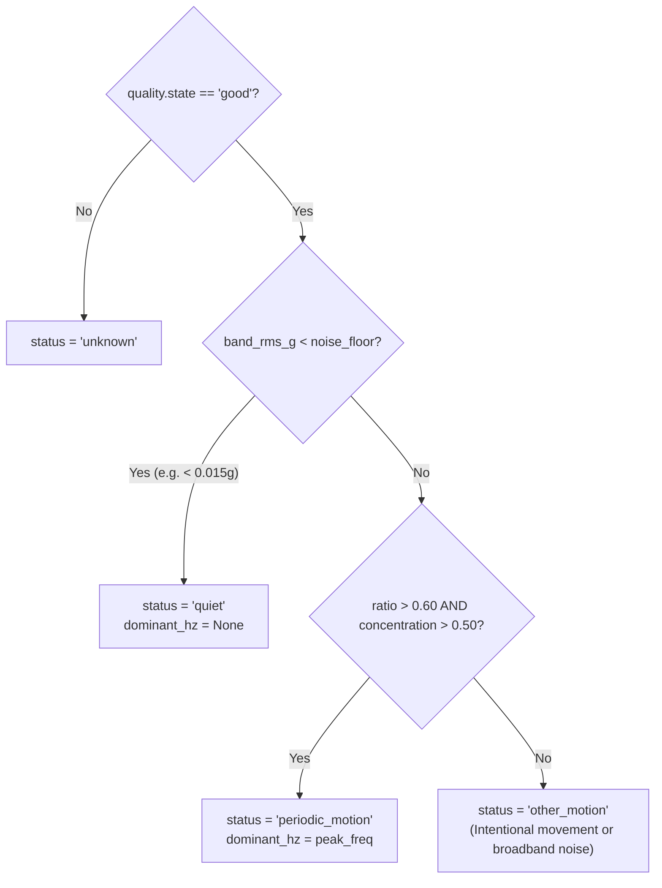

# Motion Quality and Advisory Output Plan (`analysis/plans/motion-quality-and-advisory-output.md`)

**Owner:** Person 4 (Dedeepya)  
**Status:** Planned / Architecture Phase  

---

## 1. Purpose and Ownership

This document specifies the motion classification logic, quality gating, and advisory recommendation generation in `steadyhand_signal.state`. It translates raw spectral features into actionable, honest system states.

### Core Philosophy: Honest Null Outputs
When an analysis window is corrupted, degraded, or experiencing sensor blanking, numerical metrics (`dominant_hz`, `band_rms_g`, `peak_concentration`) MUST be returned as `None` (or `null` in JSON). Under no circumstances should the library fabricate plausible-looking numbers from invalid data.

---

## 2. Signal Quality State Machine

| Quality State | Preconditions | Permitted Numerical Output |
| :--- | :--- | :--- |
| `warming_up` | Buffer has $<2.0\text{ s}$ of data since connection or reset. | All metrics `None`, recommendation `None`. |
| `good` | Full $2.0\text{ s}$ clean window, missing fraction $<0.05$, max gap $<40\text{ ms}$, no saturation, no haptic activity. | Full metrics calculated and published. |
| `degraded` | Missing fraction $\ge 0.05$, max gap $\ge 40\text{ ms}$, or sensor clipping/saturation detected. | All metrics `None`, recommendation `None`. |
| `stale` | No new sample received for $>500\text{ ms}$ (detected by service layer). | All metrics `None`, recommendation `None`. |
| `haptic_blanking` | Window overlaps active vibration pulse or $500\text{ ms}$ settling interval. | All metrics `None`, recommendation `None`. |
| `unavailable` | Peripheral disconnected or unconfigured. | All metrics `None`, recommendation `None`. |

---

## 3. Motion Classification Rules (`classify_motion`)

Operates strictly when `quality.state === 'good'`:



### Persistence and Hysteresis
To prevent rapid flickering between `quiet` and `periodic_motion`:
- **Acquisition Condition:** Requires **2 consecutive windows** ($500\text{ ms}$) meeting the periodic motion criteria before transitioning to `periodic_motion`.
- **Release Condition:** Requires **3 consecutive windows** ($750\text{ ms}$) below the threshold before returning to `quiet`.

---

## 4. Advisory Preset Recommendation

Recommendations are formulated to help the user choose an assistance preset:

1. **`steady` Preset Recommendation:**
   - **Condition:** Persistent `periodic_motion` for $>2.0\text{ seconds}$ during task activity, with $\text{RMS}_{band} > 0.03\text{ g}$.
   - **Payload:**
     ```json
     {
       "id": "rec-steady-01",
       "preset": "steady",
       "requires_user_acceptance": true,
       "reason_code": "persistent_motion_during_task"
     }
     ```
2. **`light` Preset Recommendation:**
   - **Condition:** Persistent `quiet` or `other_motion` with low band energy ($\text{RMS}_{band} < 0.02\text{ g}$).
3. **Rejection / Null:**
   - If quality is not `good`, recommendation is strictly `None`.

---

## 5. Acceptance Criteria

- Corrupted windows return `dominant_hz = None` and `recommendation = None`.
- Brief single-window noise spikes do not trigger `periodic_motion` (persistence verified).
- Recommendations always require user acceptance (`requires_user_acceptance = true`).

---

## 6. Copy-Ready Implementation Prompt

```text
You are Person 4 (Dedeepya) implementing motion quality and advisory state in steadyhand_signal.state.

Read analysis/plans/motion-quality-and-advisory-output.md and docs/contracts.md.

ALLOWED EDITS:
- analysis/src/steadyhand_signal/state.py
- tests/analysis/**

TASK:
1. Implement classify_motion applying quality gates, noise floor thresholds, and hysteresis.
2. Implement generate_recommendation creating advisory presets with requires_user_acceptance=True.
3. Enforce that non-'good' quality windows always set metrics and recommendations to None.
4. Implement tests/analysis/test_state.py verifying hysteresis and null output safety.
```
