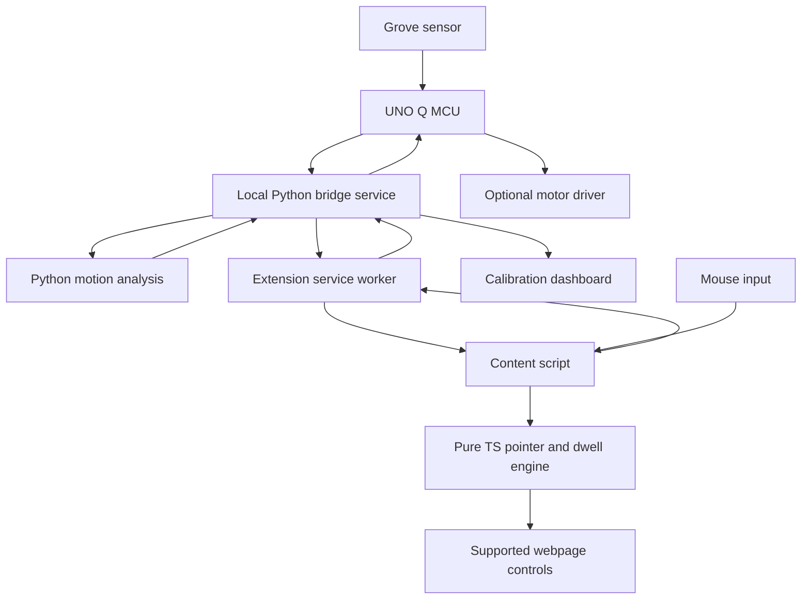

# Runtime architecture

> **Interactive V2 Architecture Diagram**: Open [architecture-diagram.html](architecture-diagram.html) for an interactive, full-fidelity visualization of SteadyHand V2 components, data flows, and security boundaries.

## 1. Component boundaries

The pointer loop is `mouse → content script → engine → overlay/eligible action`. The sensor loop is slower and advisory. Loss of the slower loop never stalls the pointer loop.

## 2. Chrome contexts

| Context | Owner | Responsibility |
| --- | --- | --- |
| Popup and options UI | Kripa, mounted by Person 3 | User controls, connection settings, enable/disable, explicit preset acceptance |
| MV3 service worker | Person 3 | Injection, configuration storage, backend transport, tab state, validated messages |
| Content script | Person 3 | Page observation, mouse events, DOM targets, geometry, overlay, engine integration, cancellation |
| Pure TS engine | Person 4 | Time-aware filters, target arbitration, dwell state transitions |

Content scripts run in an isolated JavaScript world while sharing the page DOM. Use that world for runtime code and a dedicated Shadow DOM host for the extension's visual overlay. Shadow DOM reduces style collisions; it is not a security boundary against the host page.

The worker owns network access. Do not let content scripts open a socket from each webpage or transmit page content to the service. No offscreen document is required for P0. Avoid inventing an offscreen API reason merely to keep a socket alive.

## 3. Permissions and enable flow

Proposed P0 permissions: `activeTab`, `scripting`, and `storage`. Declare specific loopback host access for the selected local backend. No all-site auto-injection, debugger, native messaging, downloads, or browsing-history permission is required.

The toolbar opens a popup. Its **Enable on this page** button sends an internal message to the worker. The worker resolves the active tab and injects the compiled content bundle through `chrome.scripting`. Do not rely on `chrome.action.onClicked` firing when an action popup is configured. Verify the user-triggered active-tab permission path in the actual Chrome build.

Top-frame-only operation is P0. Unsupported internal browser pages show an explanatory status instead of a broken toggle. Navigation and permission revocation require rechecking availability; do not assume an old injection survives a new document.

Persistent per-site access is P2. If added, request a specific origin through an explicit user gesture and explain the permission. Do not silently upgrade to `<all_urls>`.

## 4. Worker lifetime and transport

Use Chrome 116+ for the documented service-worker WebSocket lifecycle improvement. Exchange an application ping every 20 seconds while connected. Clear timers on close and do not create duplicate heartbeat/reconnect loops.

Still treat worker state as disposable. Recover configuration from `chrome.storage.local`; keep the pairing token in extension session storage with trusted-context access. On restart, reconnect, request a fresh snapshot, and re-establish content-script state. Never restore an in-progress dwell or replay a queued selection/haptic request.

Content scripts retain their local assistance until disabled or unloaded. Loss of worker connection marks hardware unavailable and cancels pending dwell once. Afterwards software-only interaction can continue with the current visible settings.

Backend derived frames update around 4 Hz. Raw pointer input is processed at input cadence and drawn using `requestAnimationFrame`. Do not serialize every pointer movement through the worker or server.

An optional developer-only stress adapter perturbs virtual-pointer samples with a seed. It requires explicit activation and a persistent synthetic-pointer label independent of sensor source. Raw-virtual and filtered comparisons use the same input. Normal native mode never pretends to move the OS cursor.

## 5. Backend and UNO Q

Dev builds a FastAPI service with interchangeable adapters: `mock`, `replay`, and `uno_q`. The selected adapter is a launch-time setting, shown in every source label. The service imports Person 4's Python analysis package rather than reimplementing it.

Acquisition runs on the UNO Q MCU. Its Linux side can run the Python service and use the supported Arduino bridge. Prove the actual installed bridge API with a tiny round trip before implementing abstractions. An ordinary UNO R3-style USB serial path is not assumed.

**Preferred browser endpoint:** loopback on the demo laptop. If the service runs on the board, Dev verifies SSH or another documented forwarding route from the laptop to the board-local service. A candidate, after actual hostname/login are established, is SSH local port forwarding from laptop port 8765 to board loopback port 8765. Do not assume USB establishes this route.

**Alternative:** a service at a configured board LAN address. Test permissions, connectivity, and browser local-network behavior early; use the real endpoint in extension and dashboard configuration. Do not disable browser security flags to make the demo work. LAN operation needs explicit pairing and a restricted origin policy. For deployment beyond a controlled local prototype, secure transport and a stronger threat model are additional work.

If the board service cannot run the numerical dependencies, preserve acquisition on the board and move service/analysis to the laptop only after verifying a supported data route. This is an adapter deployment decision, not a new frontend protocol.

## 6. Configuration authority

The extension worker is authoritative for pointer settings. Popup/options update one validated configuration in `chrome.storage.local` with an increasing `revision`, then broadcast it to enabled tabs. Every applied revision cancels pending dwell and resets filter state.

The dashboard owns calibration, device inspection, and benchmark presentation. It displays a recommended preset; the user accepts it in the extension popup. P0 does not require cross-origin dashboard-to-extension messaging or competing settings databases. The dashboard's preview controls affect its preview only and must be labeled accordingly.

Backend calibration settings, source mode, and actuator capability are separate from pointer settings. A sensor frame never changes pointer settings automatically.

## 7. Pairing and message boundaries

The service creates a short-lived local pairing token, displayed in the launch console. The dashboard and extension options let the operator enter it. HTTP uses a bearer header. WebSocket sends authentication as its first frame within three seconds, then receives a snapshot. Do not put tokens in URLs or log them.

Validate WebSocket Origin against the configured extension ID and local dashboard origin; validate token and schema independently. CORS does not secure a WebSocket. Never forward entered text, HTML, complete URLs, or tokens to the content script. The worker accepts only named commands from known extension senders, not an arbitrary URL-fetch proxy.

No telemetry endpoint accepts arbitrary GPIO, unbounded motor durations, or generic page action instructions. The backend cannot click websites.

## 8. Fault transitions

| Transition | Behavior |
| --- | --- |
| Backend closes | Mark device unavailable, cancel dwell once, keep manual pointer assistance |
| Sensor stalls | Quality stale; recommendations stop; backend connection may still be healthy |
| MCU boot ID changes | Clear analysis/calibration and pending hardware state |
| Page changes layout | Invalidate target, cancel dwell, rescan before rearming |
| Tab hides or loses the relevant input state | Cancel dwell and clear click arming |
| Disable | Remove listeners, observers, overlay, injected cursor style, and timers |
| Motor request uncertain | Motor still has MCU timeout; suppress recommendations until clean evidence returns |

The final demo should prove these transitions, not merely show the happy path. Source links and remaining verification appear in [sources.md](sources.md).
