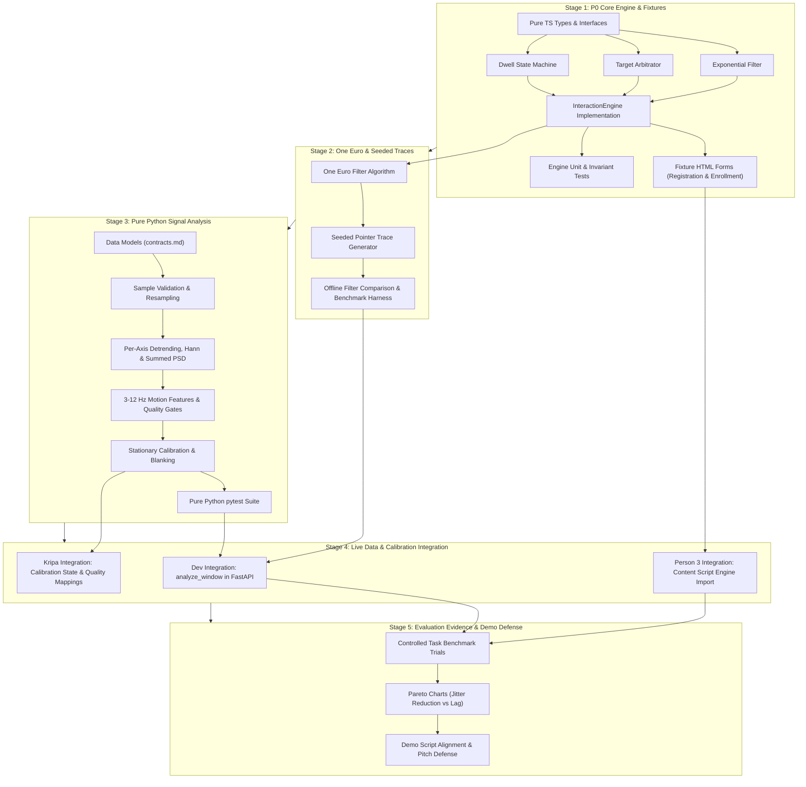

# Master Implementation Plan: Person 4 (Dedeepya)

**Role:** Person 4 — Algorithms, Signal Processing, Test Fixtures, and Evaluation  
**Owner:** Dedeepya  
**Branch:** `planning/dedeepya`  
**Status:** Planning Phase (No application code implemented yet)

---

## 1. Role and Ownership Boundaries

As Person 4, I own the mathematical, algorithmic, evaluation, and test fixture subsystems for SteadyHand. My work spans two distinct programming runtimes:
- **TypeScript:** The client-side, browser-independent pure pointer interaction engine (`packages/engine/`).
- **Python:** The backend pure sensor signal processing library (`analysis/steadyhand_signal`).
- **Fixtures & Evidence:** Synthetic trace generators, uninstrumented HTML test pages, recorded IMU dataset schemas, unit/property test suites, and honest engineering evaluation evidence (`fixtures/`, `apps/fixtures/`, `tests/`, `evidence/`).

### Strict Ownership Matrix

| Directory | Ownership Status | Primary Purpose & Contents |
| :--- | :--- | :--- |
| `packages/engine/` | **Full Ownership** | Pure TS pointer engine: filters, targeting, dwell state machine. Zero DOM, Chrome, or backend imports. |
| `analysis/` | **Full Ownership** | Pure Python signal library `steadyhand_signal`: window validation, PSD, motion features, calibration. Zero FastAPI or device I/O. |
| `apps/fixtures/` | **Full Ownership** | Independent HTML fixture pages with semantic form controls and target acquisition tasks for browser testing. |
| `fixtures/` | **Full Ownership** | Deterministic synthetic pointer traces and IMU datasets, recording schemas, replay harnesses. |
| `tests/engine/` | **Full Ownership** | Unit, invariant, and property tests for the TypeScript interaction engine. |
| `tests/analysis/` | **Full Ownership** | Unit, numerical, and spectral tests for the Python signal analysis library. |
| `evidence/` | **Full Ownership** | Quantitative evaluation results, Pareto trade-off curves (jitter vs lag), task completion logs, and demo claims. |
| `docs/implementation/dedeepya.md` | **Full Ownership** | This master planning document and roadmap. |

### Forbidden Directories (Must NOT Edit)

- `packages/contracts/` (Owned by **Dev**; I propose additions via interface requests).
- `services/bridge/` (Owned by **Dev**; backend FastAPI service, WebSocket server, adapters).
- `firmware/unoq/` (Owned by **Dev**; Arduino C++ MCU code, I2C driver, router bridge).
- `apps/dashboard/` (Owned by **Kripa**; React/Vite dashboard application).
- `apps/extension/` (Owned by **Person 3** for runtime/content script; owned by **Kripa** for popup/options).
- `packages/ui/`, `design/` (Owned by **Kripa**; design tokens, UI components).
- Root build manifests (`package.json`, `pnpm-workspace.yaml`, `pnpm-lock.yaml`, `tsconfig.base.json`).

---

## 2. Current Repository Findings

A comprehensive inspection of the workspace and repository history reveals:
1. **Existing Documentation:** Rich foundational documentation exists in `docs/` (`architecture.md`, `contracts.md`, `hardware.md`, `testing.md`, `demo.md`, `ux.md`, `workflow.md`, `sources.md`), `teams/` (`01_dev.md` through `04_algorithms.md`), `AGENTS.md`, and `plan.md`.
2. **Current Implementation State:** Zero application code currently exists. All owned directories (`packages/engine/src/`, `analysis/src/`, `apps/fixtures/`, `fixtures/`, `tests/`, `evidence/`) consist of empty scaffolding and initial `README.md` placeholder files.
3. **Hardware Grounding:** The exact model of the Grove accelerometer is unconfirmed (candidates: LIS3DHTR at `0x19`, ADXL345 at `0x53`, MMA7660FC at `0x4C`). Furthermore, an actuator/motor driver is unconfirmed. All sensor analysis must be strictly capability-driven, parameterized by negotiated sample rate and scale, and treat haptics as optional P1 functionality.
4. **Integration Grounding:** Canonical contracts are defined in `docs/contracts.md` (v1). The engine interface is specified as `InteractionEngine` consuming `Point` and `Target` rects and producing `EngineOutput`. The Python interface is specified as `analyze_window` and `calibrate_stationary`.

---

## 3. Directory Index and Plan Links

This master plan coordinates 39 focused planning documents across my owned directories:

### Pointer Engine (`packages/engine/`)
- [`packages/engine/PLAN.md`](file:///c:/Dedee/SteadyHand_Extension_Full_Plan/packages/engine/PLAN.md): Subsystem overview, lifecycle, and packaging plan.
- [`packages/engine/src/PLAN.md`](file:///c:/Dedee/SteadyHand_Extension_Full_Plan/packages/engine/src/PLAN.md): Internal source architecture and exports.
- [`packages/engine/src/filters/PLAN.md`](file:///c:/Dedee/SteadyHand_Extension_Full_Plan/packages/engine/src/filters/PLAN.md): Smoothing algorithms module plan.
- [`packages/engine/src/targeting/PLAN.md`](file:///c:/Dedee/SteadyHand_Extension_Full_Plan/packages/engine/src/targeting/PLAN.md): Target candidate arbitration module plan.
- [`packages/engine/src/dwell/PLAN.md`](file:///c:/Dedee/SteadyHand_Extension_Full_Plan/packages/engine/src/dwell/PLAN.md): Dwell state machine module plan.
- [`packages/engine/plans/public-api-and-integration.md`](file:///c:/Dedee/SteadyHand_Extension_Full_Plan/packages/engine/plans/public-api-and-integration.md): Public TypeScript contracts and Person 3 integration.
- [`packages/engine/plans/pointer-filtering.md`](file:///c:/Dedee/SteadyHand_Extension_Full_Plan/packages/engine/plans/pointer-filtering.md): Raw bypass, Exponential filter, and One Euro speed-adaptive filter.
- [`packages/engine/plans/target-acquisition.md`](file:///c:/Dedee/SteadyHand_Extension_Full_Plan/packages/engine/plans/target-acquisition.md): Bounded capture radius, hysteresis, and ambiguity arbitration.
- [`packages/engine/plans/dwell-state-machine.md`](file:///c:/Dedee/SteadyHand_Extension_Full_Plan/packages/engine/plans/dwell-state-machine.md): Dwell FSM states, monotonic timing, exactly-once selection, and rearm.
- [`packages/engine/plans/calibration-and-presets.md`](file:///c:/Dedee/SteadyHand_Extension_Full_Plan/packages/engine/plans/calibration-and-presets.md): Presets (Light, Steady, Custom) and advisory parameter mapping.
- [`packages/engine/plans/timing-reset-and-failure-handling.md`](file:///c:/Dedee/SteadyHand_Extension_Full_Plan/packages/engine/plans/timing-reset-and-failure-handling.md): Variable sample rates, pauses, nonfinite inputs, and state resets.
- [`packages/engine/plans/performance-and-benchmarks.md`](file:///c:/Dedee/SteadyHand_Extension_Full_Plan/packages/engine/plans/performance-and-benchmarks.md): Execution budget (<0.5 ms/step), garbage reduction, and benchmarks.

### Sensor Analysis (`analysis/`)
- [`analysis/PLAN.md`](file:///c:/Dedee/SteadyHand_Extension_Full_Plan/analysis/PLAN.md): Python analysis architecture and environment specification.
- [`analysis/src/PLAN.md`](file:///c:/Dedee/SteadyHand_Extension_Full_Plan/analysis/src/PLAN.md): Package layout for `steadyhand_signal`.
- [`analysis/src/steadyhand_signal/PLAN.md`](file:///c:/Dedee/SteadyHand_Extension_Full_Plan/analysis/src/steadyhand_signal/PLAN.md): Module decomposition and pure numerical functions.
- [`analysis/plans/sample-validation-and-timebase.md`](file:///c:/Dedee/SteadyHand_Extension_Full_Plan/analysis/plans/sample-validation-and-timebase.md): Monotonicity, timestamp rollover, gaps, loss, and resampling.
- [`analysis/plans/windowing-and-spectral-analysis.md`](file:///c:/Dedee/SteadyHand_Extension_Full_Plan/analysis/plans/windowing-and-spectral-analysis.md): 2s rolling window, detrending, Hann window, PSD per axis, and power summing.
- [`analysis/plans/motion-quality-and-advisory-output.md`](file:///c:/Dedee/SteadyHand_Extension_Full_Plan/analysis/plans/motion-quality-and-advisory-output.md): Motion classification, quality gates, and null metric handling.
- [`analysis/plans/calibration-and-baselines.md`](file:///c:/Dedee/SteadyHand_Extension_Full_Plan/analysis/plans/calibration-and-baselines.md): Stationary baseline capture, noise floor, and mount invalidation.
- [`analysis/plans/haptic-artifact-handling.md`](file:///c:/Dedee/SteadyHand_Extension_Full_Plan/analysis/plans/haptic-artifact-handling.md): Actuator pulse blanking, settling intervals, and contamination recovery.
- [`analysis/plans/backend-integration.md`](file:///c:/Dedee/SteadyHand_Extension_Full_Plan/analysis/plans/backend-integration.md): FastAPI service integration for Dev (`analyze_window`, `calibrate_stationary`).

### Controlled Demonstration Pages (`apps/fixtures/`)
- [`apps/fixtures/PLAN.md`](file:///c:/Dedee/SteadyHand_Extension_Full_Plan/apps/fixtures/PLAN.md): Fixture app server and static page architecture.
- [`apps/fixtures/plans/supported-form-controls.md`](file:///c:/Dedee/SteadyHand_Extension_Full_Plan/apps/fixtures/plans/supported-form-controls.md): Layout 1 (Service Registration) & Layout 2 (Course Enrollment).
- [`apps/fixtures/plans/target-acquisition-tasks.md`](file:///c:/Dedee/SteadyHand_Extension_Full_Plan/apps/fixtures/plans/target-acquisition-tasks.md): Discrete target acquisition tasks with controlled target sizes and distances.
- [`apps/fixtures/plans/dynamic-page-and-cancellation-cases.md`](file:///c:/Dedee/SteadyHand_Extension_Full_Plan/apps/fixtures/plans/dynamic-page-and-cancellation-cases.md): Layout shift, target removal, modal occlusion, and scroll edge cases.
- [`apps/fixtures/plans/experiment-controls-and-metrics.md`](file:///c:/Dedee/SteadyHand_Extension_Full_Plan/apps/fixtures/plans/experiment-controls-and-metrics.md): Unprivileged metric instrumentation, completion timing, and trial logging.

### Input Datasets (`fixtures/`)
- [`fixtures/PLAN.md`](file:///c:/Dedee/SteadyHand_Extension_Full_Plan/fixtures/PLAN.md): Dataset taxonomy, schema versioning, and directory management.
- [`fixtures/synthetic/PLAN.md`](file:///c:/Dedee/SteadyHand_Extension_Full_Plan/fixtures/synthetic/PLAN.md): Synthetic cursor trace and IMU waveform specifications.
- [`fixtures/recorded/PLAN.md`](file:///c:/Dedee/SteadyHand_Extension_Full_Plan/fixtures/recorded/PLAN.md): Physical sensor capture protocol, provenance metadata, and non-personal storage.
- [`fixtures/plans/pointer-trace-generation.md`](file:///c:/Dedee/SteadyHand_Extension_Full_Plan/fixtures/plans/pointer-trace-generation.md): Seeded generator for straight, curved, overshoot, and noisy cursor traces.
- [`fixtures/plans/sensor-signal-generation.md`](file:///c:/Dedee/SteadyHand_Extension_Full_Plan/fixtures/plans/sensor-signal-generation.md): Synthetic 3-axis IMU generator (quiet, periodic oscillation, gaps, saturation).
- [`fixtures/plans/recording-format-and-provenance.md`](file:///c:/Dedee/SteadyHand_Extension_Full_Plan/fixtures/plans/recording-format-and-provenance.md): JSON schema, unit conventions, and sensor hardware metadata tags.
- [`fixtures/plans/replay-and-reproducibility.md`](file:///c:/Dedee/SteadyHand_Extension_Full_Plan/fixtures/plans/replay-and-reproducibility.md): Deterministic replay player for unit tests and dashboard demos.

### Testing (`tests/`)
- [`tests/engine/PLAN.md`](file:///c:/Dedee/SteadyHand_Extension_Full_Plan/tests/engine/PLAN.md): TypeScript Vitest suite for filters, target arbitration, and dwell FSM.
- [`tests/analysis/PLAN.md`](file:///c:/Dedee/SteadyHand_Extension_Full_Plan/tests/analysis/PLAN.md): Python pytest suite for windowing, PSD, peak recovery, and quality gates.

### Evidence (`evidence/`)
- [`evidence/PLAN.md`](file:///c:/Dedee/SteadyHand_Extension_Full_Plan/evidence/PLAN.md): Evidence collection methodology, ethical guidelines, and storage policy.
- [`evidence/plans/evaluation-protocol.md`](file:///c:/Dedee/SteadyHand_Extension_Full_Plan/evidence/plans/evaluation-protocol.md): Benchmark protocol comparing Native, Raw Virtual, Exponential, and One Euro.
- [`evidence/plans/benchmark-results-and-plots.md`](file:///c:/Dedee/SteadyHand_Extension_Full_Plan/evidence/plans/benchmark-results-and-plots.md): Automated chart generator for tracking error, Pareto curves, and PSD plots.
- [`evidence/plans/demo-evidence-and-claims.md`](file:///c:/Dedee/SteadyHand_Extension_Full_Plan/evidence/plans/demo-evidence-and-claims.md): Hackathon pitch defense script, technical claims boundaries, and disclaimers.

---

## 4. Complete Proposed Source and Documentation Tree

Below is the complete proposed file hierarchy for Dedeepya's owned folders:

```text
packages/engine/
├── README.md
├── PLAN.md                                    # Root engine plan
├── package.json                               # @steadyhand/engine package manifest
├── tsconfig.json                              # Strict TS configuration
├── plans/
│   ├── public-api-and-integration.md
│   ├── pointer-filtering.md
│   ├── target-acquisition.md
│   ├── dwell-state-machine.md
│   ├── calibration-and-presets.md
│   ├── timing-reset-and-failure-handling.md
│   └── performance-and-benchmarks.md
└── src/
    ├── PLAN.md                                # Engine src architecture plan
    ├── index.ts                               # Public exports
    ├── types.ts                               # Pure TypeScript domain models
    ├── engine.ts                              # InteractionEngine implementation
    ├── filters/
    │   ├── PLAN.md                            # Filters module plan
    │   ├── types.ts                           # IPointerFilter interface
    │   ├── passthrough.ts                     # Raw virtual bypass filter
    │   ├── exponential.ts                     # Time-aware exponential filter
    │   └── one_euro.ts                        # Speed-adaptive One Euro filter
    ├── targeting/
    │   ├── PLAN.md                            # Targeting module plan
    │   ├── types.ts                           # Target geometry and candidate models
    │   ├── distance.ts                        # Euclidean distance to rect boundaries
    │   └── arbitrator.ts                      # Ambiguity rejection & hysteresis
    └── dwell/
        ├── PLAN.md                            # Dwell module plan
        ├── types.ts                           # Dwell states and transition events
        └── state_machine.ts                   # Monotonic cancellable dwell FSM

analysis/
├── README.md
├── PLAN.md                                    # Root analysis plan
├── pyproject.toml                             # Poetry/flit/pip package config
├── plans/
│   ├── sample-validation-and-timebase.md
│   ├── windowing-and-spectral-analysis.md
│   ├── motion-quality-and-advisory-output.md
│   ├── calibration-and-baselines.md
│   ├── haptic-artifact-handling.md
│   └── backend-integration.md
└── src/
    ├── PLAN.md                                # Analysis src plan
    └── steadyhand_signal/
        ├── PLAN.md                            # Library architecture plan
        ├── __init__.py                        # Package exports (analyze_window, calibrate_stationary)
        ├── models.py                          # Typed dataclasses matching contracts.md
        ├── validation.py                      # Timing, sequence, gap, and saturation checks
        ├── resampler.py                       # Monotonic timestamp uniform resampling
        ├── spectral.py                        # Per-axis detrend, Hann window, PSD, axis sum
        ├── features.py                        # Band power (3-12 Hz), peak Hz, concentration
        ├── state.py                           # Motion state classification & persistence
        ├── calibration.py                     # Stationary noise floor & baseline subtraction
        └── blanking.py                        # Haptic pulse exclusion and settling intervals

apps/fixtures/
├── README.md
├── PLAN.md                                    # Root fixtures app plan
├── package.json                               # Lightweight dev server manifest
├── vite.config.ts                             # Local static file server
├── plans/
│   ├── supported-form-controls.md
│   ├── target-acquisition-tasks.md
│   ├── dynamic-page-and-cancellation-cases.md
│   └── experiment-controls-and-metrics.md
├── index.html                                 # Fixture navigation index
├── registration.html                          # Layout 1: Service Registration Form
├── enrollment.html                            # Layout 2: University Course Enrollment Form
├── tasks.html                                 # Target acquisition experiment task runner
├── dynamic.html                               # Layout shift, modal popup, dynamic removal tests
├── styles/
│   └── fixture.css                            # Clean semantic CSS (zero extension classes)
└── scripts/
    └── task_harness.js                        # Unprivileged trial recorder & timer

fixtures/
├── README.md
├── PLAN.md                                    # Root datasets plan
├── plans/
│   ├── pointer-trace-generation.md
│   ├── sensor-signal-generation.md
│   ├── recording-format-and-provenance.md
│   └── replay-and-reproducibility.md
├── synthetic/
│   ├── PLAN.md                                # Synthetic dataset plan
│   ├── traces/                                # Seeded JSON cursor trajectories
│   └── signals/                               # Seeded JSON 3-axis IMU batches
├── recorded/
│   ├── README.md                              # Capture instructions and hardware metadata
│   └── PLAN.md                                # Recorded traces plan
└── generators/
    ├── generate_pointer_traces.ts             # Deterministic cursor trajectory script
    └── generate_imu_signals.py                # Deterministic IMU waveform script

tests/
├── engine/
│   ├── PLAN.md                                # Engine test plan
│   ├── filter_exponential.test.ts
│   ├── filter_one_euro.test.ts
│   ├── target_arbitrator.test.ts
│   ├── dwell_fsm.test.ts
│   └── engine_invariants.test.ts
└── analysis/
    ├── PLAN.md                                # Analysis test plan
    ├── test_validation.py
    ├── test_resampler.py
    ├── test_spectral.py
    ├── test_features.py
    ├── test_calibration.py
    └── test_blanking.py

evidence/
├── README.md
├── PLAN.md                                    # Root evidence plan
├── plans/
│   ├── evaluation-protocol.md
│   ├── benchmark-results-and-plots.md
│   └── demo-evidence-and-claims.md
├── benchmarks/
│   ├── latency_vs_jitter.json                 # Pareto trade-off dataset
│   └── task_completion_summary.json           # Trial metrics across modes
├── plots/
│   ├── filter_lag_vs_noise.png
│   ├── psd_spectral_peaks.png
│   └── dwell_cancellation_rates.png
└── scripts/
    ├── run_engine_benchmarks.ts
    └── plot_spectral_evidence.py
```

---

## 5. Dependency Order

Implementation will proceed strictly in dependency order to prevent blocked teammates:



---

## 6. Milestones with Reviewable Outputs

### Milestone 1 (Hours 0–2): Agreed Engine Interface & Fixture Pages (P0)
- **Reviewable Outputs:**
  1. Compilable `@steadyhand/engine` package with exported `InteractionEngine`, `ExponentialFilter`, `TargetArbitrator`, `DwellStateMachine`.
  2. Two fully independent HTML forms (`apps/fixtures/registration.html`, `apps/fixtures/enrollment.html`) with semantic controls and zero SteadyHand dependencies.
  3. Passing unit tests verifying monotonic timing, variable $\Delta t$, exactly-once dwell activation, leave-to-rearm, and revision cancellation.
- **Handoff:** Person 3 imports `@steadyhand/engine` directly into the extension content script; tests it against the fixture forms without needing any backend or hardware.

### Milestone 2 (Hours 2–5): One Euro Filter, Seeded Traces & Pointer Benchmarks (P1)
- **Reviewable Outputs:**
  1. Verified One Euro filter implementation with speed-adaptive cutoff and derivative filtering.
  2. Synthetic cursor trace generator producing straight, curved, overshoot, and noisy trajectories with seeded pseudorandom disturbance.
  3. Automated benchmark comparing Raw Bypass vs Exponential vs One Euro on identical input traces, outputting measured tracking error (RMSE) and response delay.
- **Handoff:** Benchmark results exported for Kripa's dashboard results screen.

### Milestone 3 (Hours 5–9): Pure Python Signal Analysis & IMU Fixtures (P0 Hardware Support)
- **Reviewable Outputs:**
  1. Pure Python `steadyhand_signal` package installable via `pip install -e ./analysis`.
  2. Implementations of `analyze_window(samples, calibration, config)` and `calibrate_stationary(samples, metadata)`.
  3. Spectral analysis pipeline: per-axis detrending, Hann windowing, one-sided PSD scaling, and 3-axis power summing.
  4. Passing pytest suite verifying recovery of known oscillation frequencies (5 Hz, 8 Hz) within $\pm 0.5\text{ Hz}$ (one FFT bin) and explicit rejection of corrupted/gapped windows.
- **Handoff:** Dev imports `steadyhand_signal` directly into FastAPI rolling-window stream processing.

### Milestone 4 (Hours 9–14): Live Calibration, Blanking & System Integration (P1)
- **Reviewable Outputs:**
  1. Stationary baseline calibration rejecting unstable movement or non-stationary noise floors.
  2. Haptic blanking logic excluding actuator pulse periods and enforcing a 500 ms settling cooldown.
  3. Advisory preset recommendation mapping detected periodic motion to validated filter presets (`Light` or `Steady`).
- **Handoff:** Dev verifies live streaming batch analysis; Kripa verifies calibration progress, quality states, and recommendation cards.

### Milestone 5 (Hours 14–18): Full Task Benchmark & Evidence Bundle (P0 Evidence)
- **Reviewable Outputs:**
  1. Controlled task benchmark suite running on `apps/fixtures/tasks.html` comparing Native vs Stabilized vs Stabilized + Dwell.
  2. Reproducible benchmark scripts generating Pareto trade-off plots (jitter reduction vs latency) and trial logs.
  3. Complete `evidence/` directory containing source-labeled plots, compatibility matrix, and pitch defense documentation.

---

## 7. Interfaces Needed from Dev (Person 1)

1. **Canonical Schema Agreement (`packages/contracts`):**
   - Confirmation that `AssistanceConfig`, `Point`, `Rect`, `Target`, `EngineInput`, and `EngineOutput` in `@steadyhand/contracts` match the types declared in `docs/contracts.md`.
2. **FastAPI Import Agreement:**
   - Dev's FastAPI backend must import `steadyhand_signal` directly:
     ```python
     from steadyhand_signal import analyze_window, calibrate_stationary, MotionResult, CalibrationResult
     ```
   - Dev must pass rolling windows of structured samples conforming to `SensorBatch` with fields `t_us`, `a_g` ($[a_x, a_y, a_z]$ in units of $g$), `valid`, `saturated`, `haptic_active`.
3. **Hardware Capability Snapshot:**
   - Dev must provide sensor metadata upon connection (`model`, `bus`, `odr_hz`, `range_g`, `resolution_bits`) so that analysis parameters adapt appropriately.
4. **Haptic Pulse Notifications:**
   - Dev must tag samples with `haptic_active=True` during motor pulses and provide `haptic.pulse` start/end timestamps to allow blanking.

### 7.1 Proposed Additions to Shared Contracts (`packages/contracts`)
Recorded for Dev's review (does not modify `packages/contracts/` directly):
1. **Filter Kind Union:** Extend `filter.kind` in `AssistanceConfig` schema to explicitly validate `'exponential' | 'one_euro'`.
2. **Pointer Mode Union:** Clarify `mode` enum in `AssistanceConfig` as `'native' | 'stabilized' | 'raw_virtual'`.
3. **Target Kind Union:** Ensure `kind` in `Target` supports `'focus' | 'toggle' | 'button'`.

### 7.2 Stage 2 Implementation & Benchmark Verification Status
Implemented and verified on `planning/dedeepya`:
1. **OneEuroFilter (`packages/engine/src/filters/one_euro.ts`):** Casiez et al. (2012) speed-adaptive low-pass filter with velocity derivative filtering ($f_{c,d} = 1.0\text{ Hz}$), variable $\Delta t$ invariance, duplicate timestamp skipping ($\Delta t \le 0$), long pause snapping ($\Delta t > 1\text{ s}$), velocity clamping ($\le 10,000\text{ px/s}$), and non-finite coordinate rejection.
2. **Synthetic Pointer Trace Suite (`fixtures/generators/generate_pointer_traces.ts`):** Deterministic Mulberry32 seeded PRNG generator outputting 5 standard ground-truth benchmark traces in `fixtures/synthetic/traces/` (`stationary_jitter_seed42.json`, `straight_line_clean.json`, `straight_line_noisy_seed42.json`, `ballistic_overshoot_seed42.json`, `variable_rate_30_to_144hz.json`).
3. **Offline Pareto Engine Benchmarks (`evidence/scripts/run_engine_benchmarks.ts`):** 14 filter configurations evaluated across stationary jitter, constant velocity sweep phase lag, and ballistic tracking RMSE. Output recorded in `evidence/benchmarks/latency_vs_jitter.json`.
   - **Key Empirical Finding:** One Euro filter ($f_{c,min} = 1.0\text{ Hz}, \beta = 0.005$) achieves **70.8% stationary jitter reduction** with only **37.1 ms sweep phase lag** and **9.64 px ballistic RMSE**, compared to **151.1 ms lag and 64.53 px RMSE** for a static 1.0 Hz exponential filter.

---

## 8. Interfaces Needed from Person 3 (Extension & Browser)

1. **Normalized Viewport Coordinates:**
   - Person 3 must supply pointer samples with coordinates in CSS pixels relative to the viewport (`clientX`, `clientY`) and timestamps from `performance.now()`.
2. **Validated Target Rectangles:**
   - Person 3 must discover DOM elements, call `getBoundingClientRect()`, and map them to `Target` objects with unique, stable IDs and eligibility flags (`dwellAllowed`).
3. **Stationary Animation Frame Stepping:**
   - When the physical mouse stops moving, Person 3 must continue calling `engine.step()` on `requestAnimationFrame` using the latest raw coordinates and advancing `performance.now()` timestamps to allow dwell timers to advance.
4. **DOM Revalidation at Activation Time:**
   - Upon receiving a `selection` event from `engine.step()`, Person 3 must revalidate that the element is still connected to the DOM, visible, not occluded (via `document.elementFromPoint`), and still eligible before triggering focus or toggle.
5. **Revision Invalidation:**
   - Person 3 must increment `geometryRevision` on scroll, window resize, or dynamic DOM mutation, and pass it to `engine.step()` to automatically cancel pending dwells.

---

## 9. Information & Visualizations Needed by Kripa (Person 2)

1. **Assistance Presets:**
   - `Light`: `min_cutoff_hz = 2.5`, `beta = 0.005`, `dwell = 600 ms`.
   - `Steady`: `min_cutoff_hz = 1.0`, `beta = 0.001`, `dwell = 800 ms`.
   - `Custom`: Fully adjustable within bounded ranges.
2. **Quality & Motion Status Labels:**
   - Signal quality enum: `warming_up`, `good`, `degraded`, `stale`, `haptic_blanking`, `unavailable`.
   - Motion state enum: `quiet`, `periodic_motion`, `other_motion`, `unknown`.
   - Explicit rule: When quality is NOT `good`, numerical motion metrics (`dominant_hz`, `band_rms_g`) must be rendered as empty/null, never zero or fake numbers.
3. **Spectral Plot Format:**
   - Frequency axis: 0.0 Hz to Nyquist ($F_s / 2 \approx 50\text{ Hz}$ or $60\text{ Hz}$), resolution $\Delta f = 0.5\text{ Hz}$.
   - Amplitude axis: Power Spectral Density in $g^2/\text{Hz}$.
   - Highlight band: 3.0 Hz to 12.0 Hz exploratory movement band.
4. **Benchmark Summary Schema:**
   - Trial attempts, completion count, timeouts, average task completion time, dwell cancellation count.

---

## 10. Mock Strategies to Unblock Work

To ensure zero dependencies on teammates during early phases:
1. **Mock Pointer Feed:** A TypeScript generator that feeds synthetic mouse traces (stationary with Gaussian jitter, linear sweeps, rapid directional changes) directly into `engine.step()`.
2. **Mock DOM Targets:** Hardcoded arrays of `Target` rectangles representing standard form controls (buttons, text inputs, checkboxes) placed at known viewport coordinates.
3. **Mock IMU Waveforms:** Python-generated synthetic arrays of 3-axis accelerometer readings containing pure sine waves (5 Hz, 8 Hz), white noise, gravitational DC offsets, gapped bursts, and saturated pulses.
4. **Mock Backend Loop:** A standalone Python script running a sliding window loop over synthetic IMU data to benchmark `analyze_window` execution time without running FastAPI or WebSockets.

---

## 11. Risks and Fallback Decisions

| Potential Failure / Risk | Immediate Fallback Decision | Impact on Pitch & Product |
| :--- | :--- | :--- |
| **UNO Q hardware delayed or I2C unstable** | Fall back to pre-recorded IMU traces and synthetic streams. The software-only pointer engine in the extension continues to function flawlessly. | Pitch demonstrates full software product live, and shows hardware pipeline via recorded traces with explicit labels. |
| **Grove accelerometer resolution too coarse (e.g. 6-bit MMA7660FC)** | Detect quantization step size during calibration; flag low-amplitude movement as below noise floor; restrict recommendations to deliberate high-amplitude movement. | Demonstrates honest engineering transparency rather than claiming impossible precision. |
| **No vibration motor available** | Disable haptic feedback capability (`capabilities.haptics = false`); visual confirmation on the webpage overlay remains the sole selection cue. | Core product unaffected; haptic blanking pipeline verified via synthetic test fixtures. |
| **Dwell activation misfires on complex web apps** | Restrict dwell eligibility in P0 strictly to focusing `<input>`/`<textarea>` and toggling `<input type="checkbox">` / `<input type="radio">`. Submit buttons require physical clicks. | Guarantees safety and prevents accidental form submissions or irreversible actions. |
| **Excessive filter lag reported by users** | Provide the `Light` preset and document the mathematical Pareto trade-off between jitter suppression and phase delay in the evidence bundle. | Positions lag vs stability as an intentional user-controlled preference rather than a defect. |

---

## 12. Acceptance Checklist

- [ ] All 39 planned documents created inside my authorized paths (`packages/engine/`, `analysis/`, `apps/fixtures/`, `fixtures/`, `tests/`, `evidence/`).
- [ ] No files modified in `packages/contracts/`, `services/bridge/`, `firmware/unoq/`, `apps/dashboard/`, `apps/extension/`, `packages/ui/`.
- [ ] Pointer engine code contains zero imports from DOM, Chrome API, React, or Node.js network libraries.
- [ ] Python signal analysis contains zero imports from FastAPI, starlette, serial, or Arduino libraries.
- [ ] All units consistently use CSS pixels, monotonic milliseconds (`performance.now()`), MCU microseconds (`t_us`), acceleration in $g$, and frequencies in Hz.
- [ ] Every plan includes the mandatory 9-section structure, ending with a copy-ready implementation prompt.
- [ ] Git branch `planning/dedeepya` created and pushed to GitHub remote `https://github.com/gyandevj/SteadyHands.git`.

---

## 13. Exact First Implementation Prompt

When ready to begin Stage 1 implementation, copy and paste this exact prompt into the coding agent:

```text
You are Person 4 (Dedeepya) implementing Stage 1 of the SteadyHand pointer engine and test fixtures.

Read AGENTS.md, plan.md, docs/contracts.md, packages/engine/PLAN.md, packages/engine/plans/public-api-and-integration.md, packages/engine/plans/pointer-filtering.md, packages/engine/plans/target-acquisition.md, packages/engine/plans/dwell-state-machine.md, and apps/fixtures/plans/supported-form-controls.md.

YOUR BOUNDARIES:
- Only create and modify files inside packages/engine/, apps/fixtures/, and tests/engine/.
- Do NOT edit packages/contracts/, services/bridge/, firmware/, apps/dashboard/, apps/extension/, packages/ui/, or root config files.
- The pointer engine MUST be pure TypeScript with NO dependencies on Chrome APIs, DOM elements (window, document, HTMLElement), React, or backend networking.

DELIVERABLES:
1. Implement pure domain types in packages/engine/src/types.ts matching docs/contracts.md (Point, Rect, Target, EngineInput, EngineOutput, AssistanceConfig, SelectionEvent).
2. Implement packages/engine/src/filters/exponential.ts with time-aware variable-dt smoothing: alpha = 1 - exp(-2 * pi * cutoff * dt).
3. Implement packages/engine/src/targeting/arbitrator.ts with Euclidean distance to rectangle boundaries, capture radius, ambiguity rejection margin, and hysteresis.
4. Implement packages/engine/src/dwell/state_machine.ts with states (Idle, CandidateAcquired, Dwelling, Activated, RearmPending), monotonic dt progress, exactly-once activation, cancel on geometry/config revision changes, and leave-to-rearm logic.
5. Implement packages/engine/src/engine.ts tying filters, targeting, and dwell together into InteractionEngine with step(), cancel(), reset(), and applyConfig().
6. Implement two independent HTML fixture forms in apps/fixtures/ (registration.html and enrollment.html) using standard semantic form controls (inputs, checkboxes, radios, buttons) with zero SteadyHand-specific scripts or classes.
7. Implement unit tests in tests/engine/ verifying:
   - Variable dt filter smoothing and pause recovery.
   - Ambiguous targets yield no candidate.
   - Stationary repeated steps advance dwell progress.
   - Long hover fires exactly one selection event until target exit.
   - Revision change immediately cancels pending dwell.

Run all tests and provide a concise summary of created files, test results, and the handoff interface for Person 3. Stop before implementing One Euro filter or Python analysis.
```
