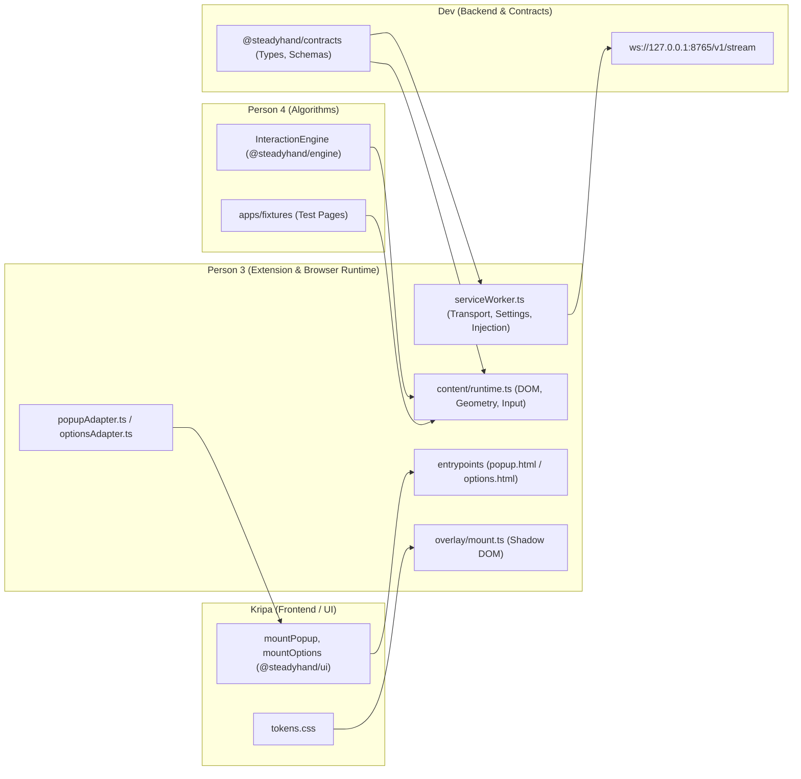

# Sector Implementation Plan: Chrome Extension and Browser Integration

**Role:** Person 3 (Chrome Extension & Browser Integration Specialist)  
**Assigned Sector Paths:** `apps/extension/` (excluding `src/popup/` and `src/options/`), `tests/extension/`  
**Canonical Spec References:** `AGENTS.md`, `plan.md`, `docs/architecture.md`, `docs/contracts.md`, `docs/testing.md`, `teams/03_extension.md`, `apps/extension/README.md`  
**Output Document:** `docs/implementation/extension.md`

---

## A. Current State

### 1. Existing Assets
- **Architectural & Interface Specifications:**
  - `docs/architecture.md` specifies the runtime architecture: MV3 service worker handling transport, isolated-world content script executing local pointer filtering and target acquisition, dedicated Shadow DOM host for pointer-transparent overlay, and Kripa's popup/options mount contracts.
  - `docs/contracts.md` defines `AssistanceConfig`, internal message schemas (`page.enable`, `page.disable`, `settings.*`, `content.*`, `device.state`, `selection.confirmed`), and numerical interaction interfaces (`InteractionEngine`, `EngineInput`, `EngineOutput`, `Point`, `Rect`, `Target`).
  - `teams/03_extension.md` provides stage definitions, browser boundary rules, and non-negotiable invariants.
- **Directory Scaffolding:**
  - `apps/extension/` exists with empty subdirectories: `assets/`, `src/adapters/`, `src/background/`, `src/content/`, `src/entrypoints/`, `src/overlay/`, `src/testing/`, and Kripa's reserved UI folders `src/popup/` and `src/options/`.
  - `tests/extension/` exists as an empty directory.
  - `apps/extension/README.md` defines module scope, ownership boundaries, and packaging constraints.

### 2. Missing Assets
- **Packaging & Manifest:** No `apps/extension/manifest.json`, `package.json`, `tsconfig.json`, or bundling script (`build.mjs`).
- **Entrypoints & UI Shells:** No `popup.html`, `options.html`, `src/entrypoints/popup.tsx`, or `src/entrypoints/options.tsx`.
- **Background Service Worker:** No worker scripts (`serviceWorker.ts`, `injection.ts`, `settingsStore.ts`, `deviceTransport.ts`, `messageRouter.ts`, `tabSessions.ts`).
- **Content Runtime & Overlay:** No content script runtime (`index.ts`, `runtime.ts`, `pointerInput.ts`, `syntheticInput.ts`, `geometry.ts`, `discovery.ts`, `activation.ts`, `policy.ts`, `metrics.ts`, `cleanup.ts`) and no Shadow DOM renderer (`mount.ts`, `renderPointer.ts`, `renderTarget.ts`, `statusStrip.ts`, `overlay.css`).
- **Adapters:** No bridge adapters connecting Kripa's UI mounts to the worker messaging pipeline (`popupAdapter.ts`, `optionsAdapter.ts`).
- **Tests:** No automated test files in `tests/extension/`.

### 3. Reusable Assets & Upstream Contracts
- Canonical contract types in `docs/contracts.md` (to be published as `@steadyhand/contracts` by Dev).
- Engine interface signatures in `docs/contracts.md` (to be published as `@steadyhand/engine` by Person 4).
- Design tokens and UI mount contracts (`mountPopup`, `mountOptions`) in `docs/contracts.md` and `docs/ux.md` (to be published as `@steadyhand/ui` by Kripa).

### 4. Unverified Assumptions & Technical Risks
- **MV3 Lifecycle & WebSocket Persistence:** Chrome 116+ allows WebSockets in extension service workers, but workers suspend after ~30s of inactivity. The worker must maintain an application-level ping/pong every 20s and treat all in-memory state as disposable.
- **Isolated World vs. Shadow DOM:** The content script runs in Chrome's isolated JS world. CSS injected into the host page could leak or be overridden by aggressive page styles. The overlay must live inside an extension-owned `ShadowRoot` (`mode: 'open'` or `'closed'`) with `pointer-events: none` graphics so underlying page clicks and hover events remain native.
- **Coordinate Systems & Dynamic Viewports:** Host pages scroll, zoom, scale (`window.devicePixelRatio`), and dynamically re-render. All coordinates passed to the engine must be strict CSS viewport pixels matching `clientX`/`clientY` and `getBoundingClientRect()`.
- **At-Most-Once Action Dispatch:** Programmatic clicks dispatched via `.click()` or `.focus()` must not trigger recursive capture in the extension's own event listeners, and assisted physical clicks must suppress exactly one duplicate native event.

---

## B. Responsibilities and Boundary Ownership

### 1. Person 3 Primary Ownership
Person 3 owns all browser integration, Chrome extension runtime, and DOM execution:
- **Build & Distribution:** `apps/extension/manifest.json`, `apps/extension/package.json`, `apps/extension/tsconfig.json`, `apps/extension/build.mjs`, `apps/extension/popup.html`, `apps/extension/options.html`, `apps/extension/assets/` (packaging and manifest wiring).
- **Extension Entrypoints:** `apps/extension/src/entrypoints/popup.tsx`, `apps/extension/src/entrypoints/options.tsx`.
- **Background Worker Subsystem:** `apps/extension/src/background/**` (`serviceWorker.ts`, `injection.ts`, `settingsStore.ts`, `deviceTransport.ts`, `messageRouter.ts`, `tabSessions.ts`).
- **Content Script Subsystem:** `apps/extension/src/content/**` (`index.ts`, `runtime.ts`, `pointerInput.ts`, `syntheticInput.ts`, `geometry.ts`, `discovery.ts`, `activation.ts`, `policy.ts`, `metrics.ts`, `cleanup.ts`).
- **Overlay Subsystem:** `apps/extension/src/overlay/**` (`mount.ts`, `renderPointer.ts`, `renderTarget.ts`, `statusStrip.ts`, `overlay.css`).
- **UI Adapters:** `apps/extension/src/adapters/**` (`popupAdapter.ts`, `optionsAdapter.ts`).
- **Testing & Diagnostics:** `apps/extension/src/testing/**` (`debugSnapshot.ts`), `tests/extension/**`.

### 2. Explicit Exclusions
- **Popup & Options Implementation:** `apps/extension/src/popup/**` (`index.tsx`, `PopupApp.tsx`, `popup.css`) and `apps/extension/src/options/**` (`index.tsx`, `OptionsApp.tsx`, `options.css`) are **exclusively owned by Kripa**. Person 3 only mounts them via entrypoints.
- **UI Components & Tokens:** `packages/ui/**` and `design/**` are **owned by Kripa**.
- **Pure Numerical Engine:** `packages/engine/**` (One Euro filter, exponential smoothing, dwell state machine) is **owned by Person 4**. Person 3 never forks numerical algorithms into the content script.
- **Backend Service & Contracts:** `packages/contracts/**`, `services/bridge/**`, `firmware/unoq/**`, and root workspace config are **owned by Dev**. Person 3 never modifies canonical schemas unilaterally.
- **Python Signal Processing:** `analysis/**` is **owned by Person 4**.

### 3. Boundary Collaborators & Interfaces

---

## C. Ordered Implementation Stages

### Stage 1: Load, Packaging, and Idempotent Injection
- **Goal:** Establish production bundling with an unpacked Manifest V3 extension, isolated worker and content script entrypoints, clean popup/options entrypoints, and idempotent page injection/cleanup.
- **User-Visible / Technical Outcome:** 
  - Unpacked extension loads cleanly into Chrome 116+ without console errors or missing assets.
  - Clicking "Enable" in the popup on an eligible webpage injects the content runtime and mounts a minimal pointer-transparent test overlay.
  - Clicking "Enable" multiple times creates exactly one overlay and one listener set (idempotent guard).
  - Clicking "Disable" cleans up the overlay, listeners, and injected styles completely.
  - Internal Chrome URLs (`chrome://`, `chrome-extension://`, Web Store) display a clear "Unsupported page" state.
- **Files Created / Modified:**
  - `apps/extension/package.json`: build scripts (`build`, `watch`), dependencies (`esbuild`).
  - `apps/extension/tsconfig.json`: strict TypeScript targeting ES2022 and DOM.
  - `apps/extension/manifest.json`: MV3 declaration (`activeTab`, `scripting`, `storage`, `host_permissions: ["http://127.0.0.1:8765/*", "ws://127.0.0.1:8765/*"]`, service worker, action popup, options page).
  - `apps/extension/build.mjs`: standalone bundling script producing `dist/` with `worker.js`, `content.js`, `popup.js`, `options.js`, and copied HTML/assets.
  - `apps/extension/popup.html`, `apps/extension/options.html`: HTML shells hosting `#root` mount containers.
  - `apps/extension/src/entrypoints/popup.tsx`, `options.tsx`: mounts Kripa's `mountPopup` / `mountOptions` or clean fallback adapter shells.
  - `apps/extension/src/background/serviceWorker.ts`, `injection.ts`, `settingsStore.ts`, `messageRouter.ts`: tab injection logic, active-tab resolution, default settings store in `chrome.storage.local`.
  - `apps/extension/src/content/index.ts`, `runtime.ts`, `cleanup.ts`: content bootstrap, window guard `window.__STEADYHAND_INJECTED__`, lifecycle teardown.
  - `apps/extension/src/overlay/mount.ts`: creates host element `steadyhand-overlay-host`, attaches `ShadowRoot`, applies pointer-transparent base styles.
  - `apps/extension/src/adapters/popupAdapter.ts`: minimal implementation of `PopupAdapter` for Stage 1.
- **Important Exports / Messages / Functions:**
  - `injectContentScript(tabId: number): Promise<boolean>`
  - Messages: `page.enable`, `page.disable`, `settings.get`, `content.ready`, `content.status`
  - Global guard: `window.__STEADYHAND_INJECTED__ = { instanceId, teardown: () => void }`
- **Dependencies & Mock Strategy:**
  - Independent of backend, hardware, and Person 4's engine.
  - If Kripa's `mountPopup` is not yet available, `src/entrypoints/popup.tsx` renders a lightweight fallback UI with "Enable on this page", "Disable", and status text.
- **Acceptance Checks & Failure Modes:**
  - *Check:* Load unpacked `apps/extension/dist` into Chrome. Verify no manifest warnings.
  - *Check:* Open plain HTML test page, click "Enable" twice. Confirm `document.querySelectorAll('steadyhand-overlay-host').length === 1`.
  - *Check:* Click "Disable". Host element removed, listeners detached, cursor styles restored.
  - *Failure mode:* Attempting injection on `chrome://extensions` returns error `Cannot access a chrome:// URL`; popup shows "Unsupported internal browser page".
- **Teammate Handoff:**
  - Unlocks Kripa: Kripa can inspect the real extension popup/options HTML containers and test mounting `PopupApp`.

---

### Stage 2: Target Discovery, Dynamic Geometry, and Stabilized Rendering
- **Goal:** Observe ordinary webpage DOM controls, assign stable target IDs, compute viewport bounding boxes, listen to pointer movement, step the smoothing engine on animation frames, and render the stabilized virtual pointer and candidate target outline inside Shadow DOM.
- **User-Visible / Technical Outcome:**
  - The native mouse moves smoothly; inside supported pages, the native cursor is hidden in the assisted area and replaced by a stabilized virtual pointer.
  - Approaching a supported form control (input, textarea, checkbox, radio, button) highlights it as a candidate.
  - Dynamic page mutations (scroll, window resize, elements added or removed) update target bounding boxes without rescanning the entire DOM on every mousemove.
  - Text selection, typing, keyboard navigation, and scrolling remain completely native.
- **Files Created / Modified:**
  - `apps/extension/src/content/discovery.ts`: scans top-frame controls (`HTMLInputElement`, `HTMLTextAreaElement`, `HTMLButtonElement`), assigns document-local IDs (e.g., `sh-target-1`), ignores extension-owned and hidden nodes.
  - `apps/extension/src/content/geometry.ts`: computes viewport-relative `Rect` via `getBoundingClientRect()`, tracks scroll/resize, invalidates geometry.
  - `apps/extension/src/content/policy.ts`: classifies control eligibility (`kind: 'focus' | 'toggle' | 'button'`, `dwellAllowed`).
  - `apps/extension/src/content/pointerInput.ts`: captures `pointermove` / `mousemove`, records `clientX`, `clientY`, and `performance.now()`.
  - `apps/extension/src/content/syntheticInput.ts`: developer-only test jitter injector (strictly gated behind `mode === 'raw_virtual'` or explicit flag).
  - `apps/extension/src/overlay/renderPointer.ts`, `renderTarget.ts`, `statusStrip.ts`, `overlay.css`: SVG/Canvas/DOM virtual pointer, candidate boundary outline, ambiguity indicator, and compact status badge inside Shadow DOM.
- **Important Exports / Messages / Functions:**
  - `discoverTargets(root: Document | Element): Target[]`
  - `updateGeometry(targets: Map<string, TargetRecord>): { revision: number, targets: Target[] }`
  - `renderOverlay(state: EngineOutput, targets: Map<string, TargetRecord>): void`
- **Dependencies & Mock Strategy:**
  - Uses `@steadyhand/contracts` definitions.
  - If Person 4's `@steadyhand/engine` is not yet published to the workspace, use a temporary deterministic stub in `apps/extension/src/content/engineStub.ts` implementing `InteractionEngine` (returning smoothed coordinates via simple exponential filter). Replace with `@steadyhand/engine` immediately once published.
- **Acceptance Checks & Failure Modes:**
  - *Check:* Open Person 4's fixture pages (`service-registration.html`, `course-enrollment.html`). Supported inputs are highlighted as candidates.
  - *Check:* Scroll the page: candidate outline follows the target element exactly; pending dwell resets on scroll.
  - *Check:* Overlay mutations do not trigger discovery `MutationObserver` loops (observer explicitly ignores `steadyhand-overlay-host`).
  - *Failure mode:* Occluded elements (e.g., hidden under a modal or fixed header) fail `document.elementFromPoint(x, y)` check and are rejected as candidates.
- **Teammate Handoff:**
  - Unlocks Person 4: Person 4 can run their real `@steadyhand/engine` inside an actual browser environment on uninstrumented forms.

---

### Stage 3: Actions, Dwell Activation, and Safe Cancellation
- **Goal:** Execute at-most-once eligible activations upon dwell completion, manage physical assisted click boundaries, enforce robust cancellation (Escape, mouse exit, layout shift, tab hiding), and protect native fallbacks.
- **User-Visible / Technical Outcome:**
  - Hovering over a text input or textarea dwells for `duration_ms` (e.g., 800ms) with a visual progress indicator, then focuses the control via `.focus()`.
  - Hovering over an ordinary checkbox or radio dwells and toggles state via a single native dispatch.
  - Submit buttons, file inputs, select pickers, and payment controls **never** activate via dwell; they remain fully operable via ordinary native clicks.
  - Pressing Escape immediately cancels pending dwell and resets progress to 0.
  - Moving the pointer off the target cancels dwell immediately without activating.
  - Switching tabs (`visibilitychange` hidden) or window blur cancels pending dwell.
  - Physical assisted clicks for eligible buttons arm on mousedown and activate on mouseup only if the candidate remains valid, preventing duplicate activations.
- **Files Created / Modified:**
  - `apps/extension/src/content/activation.ts`: executes verified DOM action (`focus()`, dispatching toggle), dedup guards, dispatches `selection.confirmed` to worker.
  - `apps/extension/src/content/policy.ts`: strict rules for `dwellAllowed` (true for focus/toggle, false for submit/pickers/destructive controls).
  - `apps/extension/src/content/runtime.ts`: animation frame loop advancing dwell while stationary, wiring cancellation triggers (`keydown` Escape, `scroll`, `visibilitychange`, `blur`).
  - `tests/extension/activation.spec.ts`: automated unit/browser tests verifying single activation, rearm after leave, and cancellation.
  - `tests/extension/cleanup.spec.ts`: automated checks for listener removal and native cursor restoration.
- **Important Exports / Messages / Functions:**
  - `executeAction(target: TargetRecord, selectionId: string): boolean`
  - `handleCancellation(reason: string): void`
  - Message: `selection.confirmed` (`{ id, targetId, kind, tMs }`)
- **Dependencies & Mock Strategy:**
  - Requires Stage 2 geometry and Person 4's dwell state machine from `@steadyhand/engine`.
  - Can be tested entirely without backend service or hardware.
- **Acceptance Checks & Failure Modes:**
  - *Check:* Long dwell on checkbox toggles it once. Remaining hovered does not toggle it back; cursor must leave capture radius to rearm.
  - *Check:* Press Escape at 70% dwell progress: progress immediately drops to 0, no action occurs.
  - *Check:* Keyboard navigation (Tab, Shift-Tab, Enter, Space) and normal typing in text fields are completely unaffected.
  - *Failure mode:* Form `<button type="submit">` hovered for >2s does NOT submit form; status strip indicates "Normal interaction required".
- **Teammate Handoff:**
  - Delivers core software product (P0 Milestone). Person 3, Kripa, and Person 4 can now demonstrate software-only assistance on fixture pages.

---

### Stage 4: Service Worker Transport, Device State, and UI Adapters
- **Goal:** Connect the MV3 background service worker to Dev's WebSocket bridge (`ws://127.0.0.1:8765/v1/stream`), manage authentication, snapshots, keepalives, exponential backoff, settings synchronization, and route derived motion status to the content script and Kripa's UI adapters.
- **User-Visible / Technical Outcome:**
  - Popup and options UI display real connection state (`connected`, `connecting`, `unavailable`) and sensor source (`live`, `recorded`, `synthetic`, `unavailable`).
  - If backend is offline or disconnects, the content script marks hardware as unavailable, cancels any pending dwell once, and seamlessly continues software-only stabilization.
  - When backend reconnects, worker authenticates with pairing token within 3s, receives `state.snapshot`, and updates popup status without replaying old actions.
  - In options or popup, changing a setting increments `revision`, persists to `chrome.storage.local`, and broadcasts `settings.applied` to active tabs, which resets filter state cleanly.
  - If haptics are enabled and supported, a confirmed selection sends a bounded `haptic.request` to the worker.
- **Files Created / Modified:**
  - `apps/extension/src/background/deviceTransport.ts`: WebSocket client inside MV3 worker, first-frame `client.auth`, 20s `client.ping` keepalive, exponential backoff (1s, 2s, 4s, 8s, max 30s), snapshot caching.
  - `apps/extension/src/background/settingsStore.ts`: reads/writes `AssistanceConfig` to `chrome.storage.local`, handles revision increments.
  - `apps/extension/src/background/messageRouter.ts`: validates message schemas, routes `settings.update`, `page.enable`, `selection.confirmed`.
  - `apps/extension/src/background/tabSessions.ts`: tracks active tab IDs and document instances.
  - `apps/extension/src/adapters/popupAdapter.ts`: full `PopupAdapter` connecting Kripa's `mountPopup` to worker messages.
  - `apps/extension/src/adapters/optionsAdapter.ts`: full `OptionsAdapter` connecting Kripa's `mountOptions` to worker messages.
  - `tests/extension/worker-restart.spec.ts`: verifies recovery of settings and transport state upon service worker wakeup.
- **Important Exports / Messages / Functions:**
  - `class DeviceTransport { connect(endpoint, token): void; disconnect(): void; ... }`
  - Messages: `device.state`, `transport.state`, `settings.update`, `settings.applied`, `haptic.request`
- **Dependencies & Mock Strategy:**
  - Dev's Stage 2 mock service running on `ws://127.0.0.1:8765/v1/stream`.
  - If Dev's service is temporarily unavailable, `deviceTransport.ts` connects to an in-memory mock WebSocket server or enters `unavailable` state gracefully.
  - Kripa's real `mountPopup` and `mountOptions` replace placeholder entrypoints.
- **Acceptance Checks & Failure Modes:**
  - *Check:* Terminate background service worker via Chrome Task Manager. Re-opening popup or clicking in page wakes worker; configuration is restored from `storage.local` without replaying past clicks.
  - *Check:* Terminate backend service (`kill 8765`). Content script displays "Software assistance active · device unavailable", pointer smoothing continues uninterrupted.
  - *Failure mode:* Worker receives malformed WebSocket frame: frame rejected, no crash, error logged, transport remains healthy.
- **Teammate Handoff:**
  - Unlocks Dev and Kripa: Kripa's popup/options now talk to real backend through Person 3's adapters; Dev's mock/live frames are verified inside the browser.

---

### Stage 5: Production Hardening, Multi-Page Verification, and Fallback Matrix
- **Goal:** Package the final production extension, execute comprehensive browser compatibility tests across two uninstrumented form layouts, verify edge-case handling (dynamic SPAs, complex DOMs, uninstalled backend), and package developer evidence.
- **User-Visible / Technical Outcome:**
  - The production build in `apps/extension/dist/` operates reliably on Person 4's `service-registration.html` and `course-enrollment.html` with zero page instrumentation.
  - Full compatibility matrix documented in `evidence/compatibility.md` (text fields, checkboxes, radios, ordinary buttons, submit buttons, select dropdowns, modals, scrolled containers).
  - Clean error recovery during full system restart rehearsals (restarting browser and backend).
- **Files Created / Modified:**
  - `apps/extension/build.mjs`: production optimizations, asset copying, build verification.
  - `apps/extension/src/testing/debugSnapshot.ts`: captures non-sensitive runtime diagnostics (target counts, frame rates, geometry revision) without saving page HTML or entered text.
  - `tests/extension/geometry.spec.ts`: verifies dynamic geometry updates during complex layouts.
  - `apps/extension/README.md`: updated with exact build, load, reload, and verification commands.
- **Important Exports / Messages / Functions:**
  - `getDebugSnapshot(): ExtensionDebugSnapshot`
- **Dependencies & Mock Strategy:**
  - Requires all upstream components: Dev's service (mock or live), Kripa's UI, Person 4's fixtures and engine.
- **Acceptance Checks & Failure Modes:**
  - *Check:* Complete two uninstrumented form tasks from start to finish without keyboard trapping or unintended form submissions.
  - *Check:* Reload extension from `chrome://extensions`: old document scripts gracefully detach; fresh enable works.
  - *Failure mode:* Heavy page DOM (10,000 nodes): discovery capped at 250 targets in viewport, mutation observer debounced at 100ms, frame rate remains 60fps.
- **Teammate Handoff:**
  - Hands complete production extension to the entire team for 3-minute judging rehearsal and backup recording.

---

## D. Dependency and Handoff Table

| Dependency / Artifact | Producer | Consumer | Stage Needed | Mock / Stub Strategy | Real Integration Trigger |
| :--- | :--- | :--- | :--- | :--- | :--- |
| **`@steadyhand/contracts`** (Types, Schemas) | Dev | Person 3 | Stage 1 | Use local contract definitions directly matching `docs/contracts.md` | Import `@steadyhand/contracts` once published by Dev |
| **`mountPopup`, `mountOptions`** | Kripa | Person 3 | Stage 1 | Entrypoints render minimal HTML fallback shells with Enable/Disable buttons | Import real functions from `@steadyhand/ui` / `src/popup` / `src/options` |
| **Design tokens (`tokens.css`)** | Kripa | Person 3 | Stage 2 | Inline basic neutral CSS variables for overlay status badge | Import `@steadyhand/ui/src/tokens.css` inside Shadow DOM |
| **`InteractionEngine`** (`@steadyhand/engine`) | Person 4 | Person 3 | Stage 2 | Local deterministic `engineStub.ts` with basic exponential filter | Import `@steadyhand/engine` once published by Person 4 |
| **Uninstrumented Fixture Pages** | Person 4 | Person 3 | Stage 2 | Local static HTML test file with inputs and checkboxes | Test against Person 4's `apps/fixtures/*.html` |
| **WebSocket Endpoint (`ws://...`)** | Dev | Person 3 | Stage 4 | WebSocket mock returning synthetic `state.snapshot` and `motion.frame` | Connect to live `ws://127.0.0.1:8765/v1/stream` (mock or UNO Q adapter) |
| **Icon Assets (16, 48, 128 px)** | Kripa | Person 3 | Stage 1 | Minimal 16x16 / 48x48 / 128x128 valid PNG placeholders in `assets/` | Replace with final branded icons from Kripa |
| **`PopupAdapter` / `OptionsAdapter`** | Person 3 | Kripa | Stage 1 (Mock) / Stage 4 (Real) | Provide typed interface and stub adapter in Stage 1 | Provide full live messaging adapter in Stage 4 |
| **Overlay Target Snapshots** | Person 3 | Person 4 | Stage 2 | Export `debugSnapshot.ts` with target rectangles and timestamps | Supply real browser target recordings to Person 4's benchmark harness |

---

## E. Focused Validation Plan

### 1. High-Risk Browser & Extension Failure Modes
1. **At-Most-Once Invariant:** Dwell completion must not trigger multiple clicks or recursive event cascades.
2. **Cancellation Reliability:** Any mouse movement outside the target capture radius, Escape key press, window scroll, or page resize must immediately abort pending dwell.
3. **Native Interaction Integrity:** The extension must never intercept typing in focused inputs, prevent native scrolling, or hijack submit buttons.
4. **Service Worker Disposal & Wakeup:** Service worker termination by Chrome must not result in corrupted settings or replayed click commands upon wakeup.
5. **No Memory Leaks / Duplicate Listeners:** Repeated enabling and disabling must leave zero dangling listeners, zero DOM elements, and restored native cursor styles.

### 2. Automated Testing Suite (`tests/extension/`)
- `tests/extension/activation.spec.ts`:
  - Unit test: verify dwell completion dispatches exactly one semantic action.
  - Unit test: verify leaving target resets dwell progress without firing action.
  - Unit test: verify `policy.ts` correctly flags submit buttons as `dwellAllowed: false`.
- `tests/extension/cleanup.spec.ts`:
  - Unit test: verify `teardown()` removes `steadyhand-overlay-host`, disconnects `MutationObserver`, removes `window` listeners, and clears injected cursor styles.
- `tests/extension/geometry.spec.ts`:
  - Unit test: verify target coordinate calculation across scroll offsets and CSS transforms.
- `tests/extension/worker-restart.spec.ts`:
  - Unit test: simulate worker termination and verify state recovery from `chrome.storage.local`.

### 3. Manual Browser Verification Protocol
- **Load Verification:** Navigate to `chrome://extensions`, enable Developer Mode, click "Load unpacked", select `apps/extension/dist`. Confirm zero errors or warnings.
- **Two-Page Test:**
  - Page 1: Form with text inputs, textarea, checkbox, radio, submit button.
  - Page 2: Table/card layout with mixed button controls and dynamic additions.
  - Verify both pages operate seamlessly using the identical unpacked extension.
- **Stress & Fault Protocol:**
  - Disconnect backend service: verify status indicator transitions to "device unavailable" while virtual pointer smoothing remains 100% functional.
  - Resize browser window rapidly: verify candidate outlines track elements accurately without crashing.
  - Press `Escape` while dwell is at 90%: verify dwell aborts immediately.

---

## F. Open Questions and Cross-Sector Coordination

| Issue / Ambiguity | Conflict / Context | Impact on Person 3 | Owner to Resolve | Proposed Working Assumption |
| :--- | :--- | :--- | :--- | :--- |
| **Bundling Tooling** | `docs/repository_tree.md` lists `build.mjs` for extension, while dashboard uses Vite. | Extension content script must be a standalone single-file bundle for injection without external chunk loading issues. | Person 3 / Dev | Use lightweight `esbuild` via `apps/extension/build.mjs` to bundle worker, content script, and entrypoints into `dist/`. |
| **Popup Entrypoint Wiring** | Kripa owns `src/popup/` and `src/options/`, Person 3 owns `src/entrypoints/` and `build.mjs`. | If Kripa's files are not yet created, the build could fail. | Person 3 / Kripa | Person 3 creates `src/entrypoints/popup.tsx` with a dynamic import or fallback guard checking for `mountPopup`. |
| **Native Cursor Suppression** | Need to hide native cursor in assisted area without breaking browser UI or page exit. | Injecting `cursor: none !important` on `body` could trap users if extension crashes. | Person 3 | Injected style tag is managed with an explicit ID `steadyhand-cursor-style` and removed immediately on disable, window blur, or Escape. |
| **Button Assisted Click Scope** | Dwell is disabled for general buttons in P0, but "pointer-assisted physical click" is specified. | Need exact mechanics for button assistance without full dwell. | Person 3 / Person 4 | For buttons, the virtual pointer snaps/assists position; when user physically clicks primary mouse button, click is routed to the candidate button. |

### Proposed Changes to Shared Documents (Recorded for Coordination)
*Note: In accordance with collaboration rules, Person 3 records these proposed items here without directly modifying shared files.*

1. **Proposed for `docs/contracts.md` / `packages/contracts/` (Owner: Dev):**
   - **UI Adapter Interface exports:** Formalize `PopupAdapter` and `OptionsAdapter` interfaces in `packages/contracts/src/uiAdapter.ts` with explicit async methods (`getState(): Promise<ExtensionState>`, `enablePage(): Promise<void>`, `disablePage(): Promise<void>`, `updateSettings(patch: Partial<AssistanceConfig>): Promise<void>`, `subscribe(listener: (state: ExtensionState) => void): () => void`).
   - **Target typing in pure engine:** Ensure `Target` type exported in `@steadyhand/contracts` includes `id: string`, `rect: Rect`, `kind: 'focus' | 'toggle' | 'button'`, `enabled: boolean`, `dwellAllowed: boolean`.
   - **Mode enum:** Confirm `AssistanceConfig.mode` includes `'raw_virtual'` as a valid diagnostic test mode alongside `'stabilized'` and `'native'`.

2. **Proposed for Root Workspace Configuration (Owner: Dev):**
   - **Workspace Scripts:** Propose adding `"build:extension": "node apps/extension/build.mjs"` and `"test:extension": "vitest run tests/extension"` in root `package.json`.
   - **Shared Tsconfig:** Ensure `tsconfig.base.json` supports DOM types and ES2022 for extension packaging.

3. **Proposed for Fixtures & Evidence (Owner: Person 4):**
   - **Uninstrumented Test Pages:** Request `apps/fixtures/service-registration.html` and `apps/fixtures/course-enrollment.html` include native form validation and a mix of inputs, textareas, checkboxes, radio groups, and submit buttons with zero custom data attributes or SteadyHand hooks.

---

## G. First Implementation Prompt (Stage 1)

Copy-ready prompt to immediately execute Stage 1:

~~~text
You are implementing Person 3's Stage 1 for SteadyHand: Extension Load, Packaging, and Idempotent Injection.

Read:
- AGENTS.md
- plan.md
- docs/architecture.md
- docs/contracts.md
- teams/03_extension.md
- apps/extension/README.md

Allowed Paths to Edit:
- apps/extension/ (EXCLUDING src/popup/ and src/options/)
- tests/extension/

Do NOT edit:
- apps/extension/src/popup/
- apps/extension/src/options/
- packages/
- services/
- apps/dashboard/
- Root configuration files owned by Dev

Goals for Stage 1:
1. Create `apps/extension/package.json` and `apps/extension/tsconfig.json` for extension development.
2. Create `apps/extension/manifest.json` conforming to Manifest V3 (Chrome 116+ minimum), declaring `activeTab`, `scripting`, `storage`, and local backend host permissions (`http://127.0.0.1:8765/*`, `ws://127.0.0.1:8765/*`).
3. Create `apps/extension/build.mjs` using esbuild to bundle:
   - `src/background/serviceWorker.ts` -> `dist/worker.js` (ES module format)
   - `src/content/index.ts` -> `dist/content.js` (IIFE standalone format)
   - `src/entrypoints/popup.tsx` -> `dist/popup.js`
   - `src/entrypoints/options.tsx` -> `dist/options.js`
   - Copy `popup.html`, `options.html`, `manifest.json`, and assets to `dist/`.
4. Create placeholder icon assets in `apps/extension/assets/` (icon-16.png, icon-48.png, icon-128.png) as valid PNG files.
5. Create `popup.html` and `options.html` referencing their respective bundled scripts.
6. Implement `src/entrypoints/popup.tsx`:
   - Checks if Kripa's `mountPopup` is exported from `../popup/index.tsx`.
   - If not present yet, renders a clean fallback UI with "SteadyHand Assistance", "Enable on this page", "Disable", and status text.
7. Implement `src/background/`:
   - `serviceWorker.ts`: sets up message listener.
   - `injection.ts`: resolves active tab and injects `dist/content.js` via `chrome.scripting.executeScript`.
   - `settingsStore.ts`: initializes default `AssistanceConfig` in `chrome.storage.local`.
   - `messageRouter.ts`: handles `page.enable` and `page.disable`.
8. Implement `src/content/`:
   - `index.ts` & `runtime.ts`: idempotent injection guard checking `window.__STEADYHAND_INJECTED__`.
   - `cleanup.ts`: complete teardown function removing overlay, listeners, and styles.
9. Implement `src/overlay/mount.ts`:
   - Appends `<steadyhand-overlay-host>` to `document.body`.
   - Attaches `ShadowRoot` and injects basic pointer-transparent stylesheet.
10. Implement `src/adapters/popupAdapter.ts`:
    - Implements basic `PopupAdapter` sending `page.enable` and `page.disable` to worker.

Acceptance Criteria:
- Running `node apps/extension/build.mjs` successfully generates a valid `apps/extension/dist/` directory.
- Loading unpacked `dist/` into Chrome 116+ yields zero manifest or console errors.
- Clicking "Enable" injects the content script and creates exactly one `<steadyhand-overlay-host>` with ShadowRoot.
- Clicking "Enable" again does NOT create a duplicate overlay or duplicate listeners.
- Clicking "Disable" cleanly removes the overlay host and teardowns runtime.
- Unsupported internal pages (`chrome://*`) return a clear status message.

Deliver Handoff Report with:
- Files created
- Build and load instructions
- Checks run
- Fallback UI description
- Consumer handoff to Kripa and Person 4
~~~
