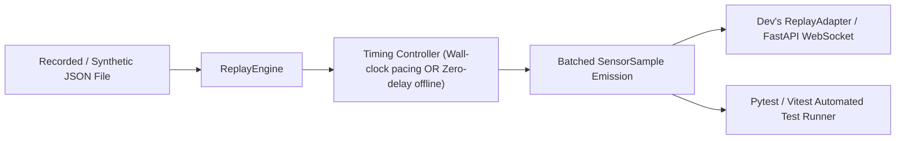

# Replay and Reproducibility Plan (`fixtures/plans/replay-and-reproducibility.md`)

**Owner:** Person 4 (Dedeepya)  
**Consumer:** Dev (Replay Adapter), Kripa (Dashboard Demo), Automated Tests  
**Status:** Planned / Architecture Phase  

---

## 1. Purpose and Ownership

This document defines the deterministic replay player for SteadyHand. It allows developers to replay previously recorded or synthetic datasets through the system as if they were live streams, enabling automated regression testing and reliable hackathon backup demonstrations.

### Golden Invariant
**Replay streams MUST retain their honest source label (`recorded` or `synthetic`).** A replayed dataset must never report `source = "live"` on the dashboard or extension status badges.

---

## 2. Replay Player Architecture



---

## 3. Replay Engine Modes

### Mode A: Real-Time Paced Replay (Demo Backup)
- Simulates live hardware streaming.
- Computes sample interval: $\Delta t_{\mu s} = t_k - t_{k-1}$.
- Sleeps for $\Delta t$ between emissions (using high-resolution timers) to stream at the exact original sample rate ($100\text{ Hz}$).
- Used during demo presentations if physical hardware is unavailable or disconnected.

### Mode B: Zero-Delay Offline Batch Replay (Unit Testing)
- Feeds all samples instantaneously into the analysis or engine pipeline.
- Enables exhaustive regression suites to run in $<1\text{ second}$ without waiting for real-time timers.

---

## 4. Implementation Details (`fixtures/replay.py`)

```python
class ReplayPlayer:
    def __init__(self, filepath: str, real_time: bool = False):
        with open(filepath, 'r') as f:
            self.data = json.load(f)
        self.samples = self.data['samples']
        self.real_time = real_time

    def stream_batches(self, batch_size: int = 10):
        # Yields SensorSample batches with honest source='recorded' or 'synthetic'
        ...
```

---

## 5. Acceptance Criteria

- Real-time replay pacing reproduces original stream duration within $\pm 1\%$.
- Output frames contain `source = "recorded"`.

---

## 6. Copy-Ready Implementation Prompt

```text
You are Person 4 (Dedeepya) implementing replay utilities in fixtures/.

Read fixtures/plans/replay-and-reproducibility.md.

ALLOWED EDITS:
- fixtures/replay.py
- fixtures/replay.ts

TASK:
1. Implement fixtures/replay.py providing real-time paced and offline batch iteration over recorded and synthetic JSON datasets.
2. Ensure source metadata is preserved.
3. Provide unit test in tests/analysis/test_replay.py.
```
