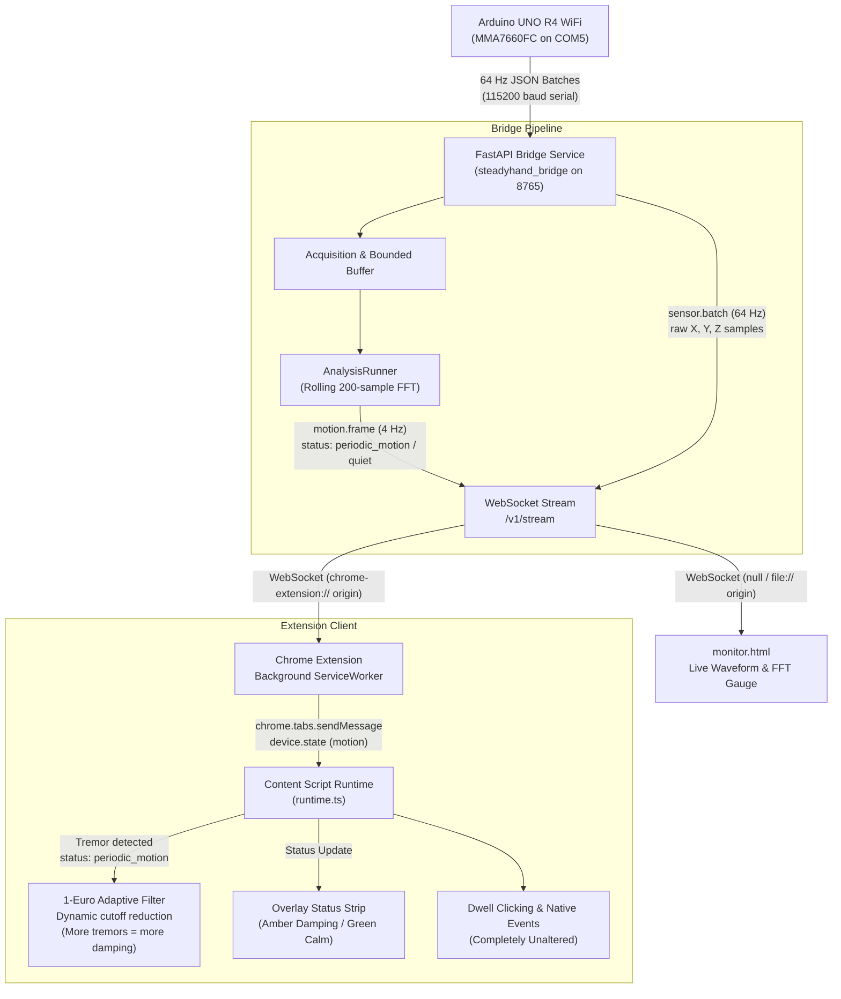

# Hardware & Extension Synchronization Plan (`hardwarefix.md`)

## 1. Goal Description
Connect the physical Arduino UNO R4 hardware (MMA7660FC sensor on `COM5`) end-to-end to:
1. **SteadyHand Diagnostics Monitor (`apps/fixtures/monitor.html`)**: Connect successfully without 403 Forbidden errors and display live 60 FPS X/Y/Z acceleration waveforms and 3–12 Hz FFT frequency peaks.
2. **Chrome Extension Runtime (`apps/extension`)**: Synchronize live hardware tremors with the 1-Euro pointer filter on webpage fixtures (e.g. `apps/fixtures/registration.html`), dynamically increasing pointer stabilization when tremors occur ("more tremors = more stabilization") while preserving local dwell clicking and cursor responsiveness.
3. **Hardware Launcher Script (`quickstart.ps1`)**: Eliminate the PowerShell argument parsing bug that caused hardware auto-detection to fail and silently fall back to `mock` mode.

---

## 2. Root Cause Analysis

### Issue A: Bridge Stays in Mock Mode Despite Hardware Plugged In (`COM5`)
* **Location**: `quickstart.ps1` lines 50–60
* **Cause**: In PowerShell, passing `$PyCmd` containing unescaped double quotes (`"USB"`, `"BTH"`) inside `python -c $PyCmd 2>$null` causes PowerShell's native process runner to strip quotes. Python fails with `SyntaxError: '(' was never closed`. Because stdout/stderr is suppressed (`2>$null`), `$Detected` evaluates to empty, and the script silently falls back to `python -m steadyhand_bridge --mode mock`.
* **Fix**: Use single quotes inside double-quoted PowerShell commands or execute port detection directly via clean PowerShell parameterization without unescaped inner strings.

### Issue B: Diagnostics Waveform (`monitor.html`) Cannot Connect (Stuck on Connecting)
* **Location**: `services/bridge/src/steadyhand_bridge/auth.py` and `config.py`
* **Cause**: When `monitor.html` is opened locally in Chrome (`file:///...`), Chrome sends `Origin: null`. `auth.py` checks `is_origin_allowed(origin, allowed_origins)`. Because `origin == "null"`, it does not match `chrome-extension://*` or default HTTP hosts, and FastAPI closes the WebSocket with `1008 Policy Violation`.
* **Fix**: Explicitly allow `origin == "null"` and `file://*` in `auth.py` and `config.py`.

### Issue C: Diagnostics Waveform Oscilloscope Remains Flat
* **Location**: `services/bridge/src/steadyhand_bridge/main.py`
* **Cause**: In `run_ingestion_loop()`, incoming 64 Hz `SensorBatch` instances are ingested into the analysis buffer, but they are never broadcasted to WebSocket subscribers (only the 4 Hz `MotionFrame` and 1 Hz `DeviceHealth` were sent). `monitor.html` relies on `msg.type === 'sensor.batch'` to push X/Y/Z samples to the oscilloscope.
* **Fix**: Broadcast `batch.model_dump()` over WebSocket when active subscribers are connected.

### Issue D: Extension Ignores Tremors and Does Not Adapt Pointer Filtering
* **Location**: `apps/extension/src/content/runtime.ts` and `apps/extension/src/overlay/statusStrip.ts`
* **Cause**:
  1. The background script `deviceTransport.ts` receives `motion.frame` and broadcasts `{ type: 'device.state', motion: { status, dominant_hz, band_rms_g } }` to tabs.
  2. However, `runtime.ts` only reads `msg.source` and ignores `msg.motion`.
  3. The 1-Euro adaptive filter in `runtime.ts` is never updated when tremor occurs.
  4. The status strip in `statusStrip.ts` always displays static text (`SteadyHand: Live Motion`) without reflecting vibration, tremor damping, or calm state.
* **Fix**:
  1. In `runtime.ts`, receive `msg.motion`.
  2. When `motion.status === 'periodic_motion'`, calculate dynamic filter tightening:
     $$\text{min\_cutoff\_hz} = \max\left(0.3,\, 1.0 - (\text{band\_rms\_g} \times 4.0)\right)$$
     $$\beta = \max\left(0.002,\, 0.015 - (\text{band\_rms\_g} \times 0.05)\right)$$
     Apply the updated parameters to `this.engine.applyConfig()`.
  3. When `motion.status === 'quiet'`, restore baseline filter parameters (`min_cutoff_hz = 1.0, beta = 0.015`).
  4. In `statusStrip.ts`, show `SteadyHand: Tremor Damping (X.X Hz)` with amber status dot during tremor, and `SteadyHand: Live Calm` with green status dot when resting.
  5. In `popup.tsx`, map `periodic_motion` and `other_motion` correctly so the popup displays live state instead of always falling back to "Resting".

---

## 3. Architecture & Data Flow



---

## 4. Proposed Changes

### Component 1: Hardware Launcher & Detection (`quickstart.ps1`)
#### [MODIFY] `quickstart.ps1`
- Fix Python port detection command syntax to safely handle PowerShell quoting.
- Ensure `-DevicePort` correctly defaults to auto-detected `COM5`.
- Provide clean fallback if hardware is absent.

```powershell
# Safe detection without inner quoting issues
$PyCmd = 'import serial.tools.list_ports as lp; pts = [p.device for p in lp.comports() if (p.vid == 0x2341 or "USB" in (p.hwid or "").upper())]; pts = pts or [p.device for p in lp.comports() if "BTH" not in (p.hwid or "").upper()]; print(pts[0] if pts else "")'
$Detected = python -c "$PyCmd" 2>$null
```

---

### Component 2: WebSocket Bridge (`services/bridge/`)
#### [MODIFY] `services/bridge/src/steadyhand_bridge/auth.py`
- Allow `origin == "null"` and `file://` schemes in `is_origin_allowed()`.

```python
def is_origin_allowed(origin: Optional[str], allowed_origins: List[str]) -> bool:
    if not origin or origin == "null":
        return True
    if origin.startswith("chrome-extension://") or origin.startswith("file://"):
        return True
    for pattern in allowed_origins:
        if fnmatch.fnmatch(origin, pattern):
            return True
    return False
```

#### [MODIFY] `services/bridge/src/steadyhand_bridge/config.py`
- Include `"null"` and `"file://*"` in `allowed_origins` default list.

#### [MODIFY] `services/bridge/src/steadyhand_bridge/main.py`
- In `run_ingestion_loop()`, broadcast raw `SensorBatch` to WebSocket clients so `monitor.html` renders real-time waveforms.

```python
if has_samples and ws_manager.active_connections:
    await ws_manager.broadcast(batch.model_dump())
```

---

### Component 3: Chrome Extension Runtime (`apps/extension/`)
#### [MODIFY] `apps/extension/src/content/runtime.ts`
- Store `deviceMotion` and `dominantHz` upon receiving `device.state` messages.
- Dynamically scale 1-Euro filter:
  - When `periodic_motion` is active: compute dynamic `min_cutoff_hz` (0.4–0.8 Hz) and `beta` (0.005–0.010) inversely proportional to tremor `band_rms_g`.
  - When `quiet` is active: restore normal configured filter settings.
- Pass motion status and dominant frequency to `updateStatusStrip()`.

#### [MODIFY] `apps/extension/src/overlay/statusStrip.ts`
- Update indicator dot and text based on motion:
  - `periodic_motion`: Amber status dot, `SteadyHand: Tremor Damping (X.X Hz)`.
  - `other_motion`: Blue status dot, `SteadyHand: Active Motion`.
  - `quiet`: Green status dot, `SteadyHand: Live Calm`.

#### [MODIFY] `apps/extension/src/entrypoints/popup.tsx`
- Map contract values `periodic_motion`, `other_motion`, and `quiet` so the popup accurately reflects hardware state.

---

## 5. Verification Plan

### Automated Tests
1. **Bridge Protocol & Auth Tests**:
   ```powershell
   pytest services/bridge
   ```
2. **Signal Analysis Tests**:
   ```powershell
   pytest tests/analysis
   ```
3. **Extension Unit Tests**:
   ```powershell
   npm --prefix apps/extension test
   ```

### Manual Verification
1. **Hardware Ingestion**:
   - Run bridge with `--mode uno_q --device-port COM5`.
   - Verify terminal logs: `UnoQDeviceAdapter: Connected to COM5`.
2. **Diagnostics Waveform (`monitor.html`)**:
   - Open `apps/fixtures/monitor.html`.
   - Verify green "Bridge Connected (Live Stream)" dot.
   - Rest sensor on table: verify calm flatline, "QUIET / RESTING" badge.
   - Shake or vibrate sensor: verify waveform spikes in real-time, dominant frequency updates (3–12 Hz), badge switches to "PERIODIC TREMOR" or "ACTIVE MOTION".
3. **Extension Synchronization (`registration.html`)**:
   - Open `apps/fixtures/registration.html` with unpacked extension loaded.
   - Verify overlay status strip shows `SteadyHand: Live Calm` (green dot).
   - Shake / vibrate sensor on hand: verify overlay status strip dynamically switches to `SteadyHand: Tremor Damping (X.X Hz)` (amber dot).
   - Verify dwell clicking and cursor stabilization continue working smoothly with zero lag or crashes.
