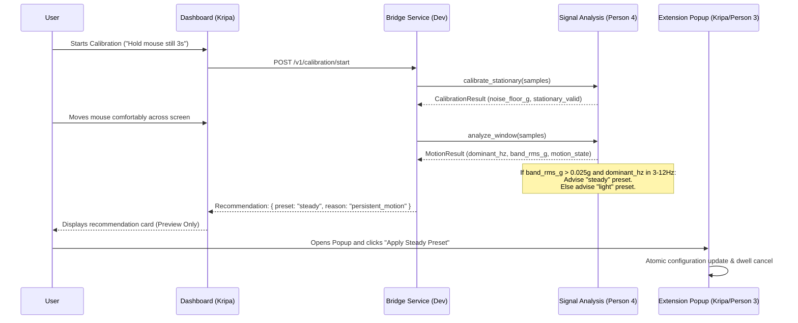

# Calibration and Presets Detailed Plan (`packages/engine/plans/calibration-and-presets.md`)

**Owner:** Person 4 (Dedeepya)  
**Consumer:** Kripa (Dashboard UI & Options), Person 3 (Extension Settings)  
**Status:** Planned / Architecture Phase  

---

## 1. Purpose and Ownership

This document defines the pointer assistance presets (`Light`, `Steady`, `Custom`) and the advisory calibration mapping. Calibration allows users to identify comfortable smoothing parameters without manual trial-and-error.

### Crucial Engineering Boundaries
1. **No Medical Claims:** Calibration measures mechanical pointer jitter and acceleration energy. It DOES NOT diagnose Parkinson’s disease, essential tremor, or any physiological disorder.
2. **User Agency & Reversibility:** Sensor analysis generates an **advisory recommendation** (`recommendation.preset = "steady"`). The extension NEVER mutates the user’s active pointer settings automatically. The user must review and explicitly accept the recommendation.
3. **Software-Only Independence:** The complete engine functions out-of-the-box with presets without requiring the sensor or calibration.

---

## 2. Assistance Presets Specification

| Parameter | Unit | Engineering Bounds | `Light` Preset | `Steady` Preset | Default |
| :--- | :--- | :--- | :--- | :--- | :--- |
| `mode` | enum | `native`, `stabilized`, `raw_virtual` | `stabilized` | `stabilized` | `stabilized` |
| `filter.kind` | enum | `exponential`, `one_euro` | `one_euro` | `one_euro` | `one_euro` |
| `filter.min_cutoff_hz` | Hz | $0.1\text{ to }10.0$ | $2.5\text{ Hz}$ | $1.0\text{ Hz}$ | $1.0\text{ Hz}$ |
| `filter.beta` | unitless | $0.0\text{ to }0.1$ | $0.005$ | $0.001$ | $0.002$ |
| `target.capture_radius_px` | px | $0\text{ to }24$ | $12\text{ px}$ | $18\text{ px}$ | $16\text{ px}$ |
| `target.ambiguity_margin_px` | px | $4\text{ to }16$ | $8\text{ px}$ | $8\text{ px}$ | $8\text{ px}$ |
| `dwell.enabled` | boolean | `true`, `false` | `true` | `true` | `true` |
| `dwell.duration_ms` | ms | $400\text{ to }2000$ | $600\text{ ms}$ | $1000\text{ ms}$ | $800\text{ ms}$ |
| `dwell.rearm_ms` | ms | $100\text{ to }1500$ | $250\text{ ms}$ | $400\text{ ms}$ | $300\text{ ms}$ |

### Preset Characteristics
- **`Light` Preset:** Aimed at mild pointer jitter. Higher cutoff ($2.5\text{ Hz}$) and responsive speed scaling ($\beta = 0.005$) minimizes cursor drag during quick navigation while smoothing small twitches. Dwell is brisk ($600\text{ ms}$).
- **`Steady` Preset:** Aimed at pronounced jitter. Aggressive low-speed filtering ($1.0\text{ Hz}$) with conservative speed scaling ($\beta = 0.001$) provides maximum target stability. Dwell is generous ($1000\text{ ms}$) to prevent accidental triggers.
- **`Custom` Preset:** User directly adjusts sliders within the engineering bounds in the options page.

---

## 3. Advisory Calibration Flow



---

## 4. Implementation Details

Exported helper in `@steadyhand/engine`:
```typescript
export const PRESETS: Record<'light' | 'steady', AssistanceConfig> = { ... };

export function resolveConfig(
  base: AssistanceConfig,
  overrides?: Partial<AssistanceConfig>
): AssistanceConfig {
  // Validate and clamp all parameters within engineering bounds
}
```

---

## 5. Failure Handling

- **Stale or Missing Calibration Data:** If the backend disconnects during calibration, the dashboard displays "Calibration incomplete; using default Steady preset."
- **Out-of-Bounds User Input:** If a user enters an extreme slider value in options (e.g. `duration_ms: 10`), `resolveConfig()` clamps the value to the minimum safe boundary ($400\text{ ms}$).

---

## 6. Acceptance Criteria

- All preset objects strictly validate against `AssistanceConfig` schema.
- Passing extreme values to `resolveConfig()` never produces `NaN` or unhandled exceptions.

---

## 7. Team Handoff

- **Receiver:** Kripa (Dashboard and Extension Options).
- **Artifact:** Exported `PRESETS` constant and `resolveConfig` function in `@steadyhand/engine`.

---

## 8. Copy-Ready Implementation Prompt

```text
You are Person 4 (Dedeepya) implementing presets and configuration validation in packages/engine/.

Read packages/engine/plans/calibration-and-presets.md and docs/contracts.md.

ALLOWED EDITS:
- packages/engine/src/**
- tests/engine/**

TASK:
1. Implement packages/engine/src/presets.ts declaring PRESETS (light, steady) and resolveConfig(config) clamping inputs to valid bounds.
2. Export PRESETS and resolveConfig from packages/engine/src/index.ts.
3. Implement tests/engine/presets.test.ts verifying clamping bounds and schema compliance.

Verify all tests pass.
```
