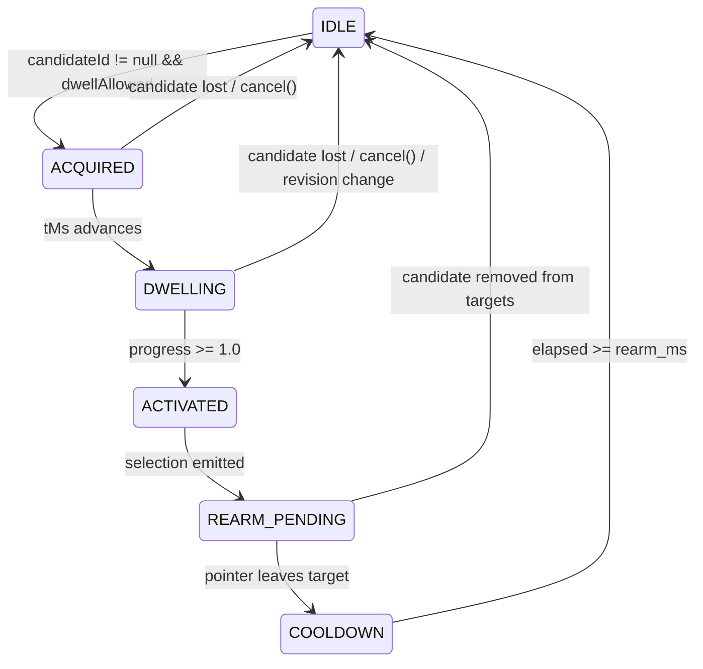

# Dwell State Machine Detailed Plan (`packages/engine/plans/dwell-state-machine.md`)

**Owner:** Person 4 (Dedeepya)  
**Status:** Planned / Architecture Phase  

---

## 1. Purpose and Ownership

This document details the state machine governing dwell-based action execution. Dwell activation is designed for users who can maneuver a pointer over a target but experience difficulty performing a discrete physical mouse button press.

### Key Distinction: Target Selection vs. Dwell Eligibility
- **Target Selection:** Any interactive target (buttons, inputs, links) can be highlighted as the active target candidate.
- **Dwell Eligibility:** Only controls marked with `dwellAllowed === true` can trigger dwell activation. In P0, dwell eligibility is granted exclusively to focusing text inputs/textareas and toggling ordinary checkboxes/radios. Generic buttons and submit actions require physical clicks to prevent unintended destructive actions.

---

## 2. Current Repository State

- Scaffolding exists in `packages/engine/src/dwell/`.
- No state machine implementation currently exists.

---

## 3. State Machine Specification

### Formal States
1. `IDLE`: No candidate target active, or target has `dwellAllowed = false`. Progress = $0.0$.
2. `ACQUIRED`: An eligible candidate is acquired. Dwell timer initialized ($t_{start} = t_{now}$).
3. `DWELLING`: Pointer remains within candidate capture boundary. Progress accumulates linearly:
   $$\text{progress}(t) = \min\left(1.0, \frac{t - t_{start}}{\text{duration\_ms}}\right)$$
4. `ACTIVATED`: Progress reaches $1.0$. The state machine emits a single `SelectionEvent`:
   ```typescript
   selection = { id: `sel-${tMs}-${counter++}`, targetId: candidate.id };
   ```
5. `REARM_PENDING`: The target has fired. While the user remains hovering over the target, further activations are strictly locked.
6. `COOLDOWN`: The user has exited the target. The target remains locked until `rearm_ms` elapses.



---

## 4. Invariant Rules and Environmental Triggers

### 1. Exactly-Once Activation
Hovering over a target for 10 seconds with `duration_ms = 800` produces **one** `SelectionEvent` at $t = 800\text{ ms}$, followed by 9.2 seconds of `selection = null` and `progress = 1.0` in `REARM_PENDING`.

### 2. Manual Physical Click Interaction
If the user performs a physical mouse click during an active dwell:
- Person 3 calls `engine.cancel("manual_click")`.
- The in-progress dwell is immediately aborted. This prevents a manual click from being immediately followed by an unintended dwell double-activation.

### 3. Geometry Revision Invalidation
When the page scrolls, resizes, or inserts dynamic elements:
- Person 3 increments `geometryRevision`.
- The engine detects `input.geometryRevision !== this.lastGeometryRevision`.
- Dwell immediately transitions to `IDLE` with `progress = 0.0`.

### 4. Tab Visibility & Window Blur
When the tab is backgrounded:
- Person 3 calls `engine.cancel("tab_hidden")`.
- Dwell state machine immediately resets to `IDLE`.

---

## 5. Implementation Sequence

1. **Phase 1:** Implement `DwellStateMachine` class in `src/dwell/state_machine.ts`.
2. **Phase 2:** Implement unit test suite verifying every state transition in the matrix.
3. **Phase 3:** Integrate with `InteractionEngine` in `src/engine.ts`.

---

## 6. Failure Handling

- **Sudden Time Skew:** If $t_{step} - t_{prev} > 1000\text{ ms}$ (e.g. computer woke from sleep), treat as an abnormal gap, cancel active dwell, and reset to `IDLE`.
- **Clock Reversal:** If $t_{step} < t_{prev}$, ignore timestamp increment; do not regress progress.

---

## 7. Acceptance Criteria

- Continuous hover emits exactly one selection event.
- Exiting target after activation requires full `rearm_ms` before re-activating same target.
- Calling `cancel()` instantly clears progress to 0.0.

---

## 8. Team Handoff

- **Receiver:** `packages/engine/src/engine.ts`.
- **Exports:** `DwellStateMachine`.

---

## 9. Copy-Ready Implementation Prompt

```text
You are Person 4 (Dedeepya) implementing the dwell state machine in packages/engine/src/dwell/.

Read packages/engine/plans/dwell-state-machine.md and docs/contracts.md.

ALLOWED EDITS:
- packages/engine/src/dwell/**
- tests/engine/**

TASK:
1. Implement packages/engine/src/dwell/types.ts declaring DwellState, SelectionEvent, and DwellConfig.
2. Implement packages/engine/src/dwell/state_machine.ts with:
   - States: IDLE, ACQUIRED, DWELLING, ACTIVATED, REARM_PENDING, COOLDOWN.
   - Monotonic time progress calculation: (tMs - startTime) / durationMs.
   - At-most-once selection emission per dwell.
   - Rearm lock preventing repeated firing while hovering.
   - Instant cancel() clearing progress.
3. Implement tests/engine/dwell.test.ts verifying all transitions and invariant rules.

Verify all tests pass.
```
