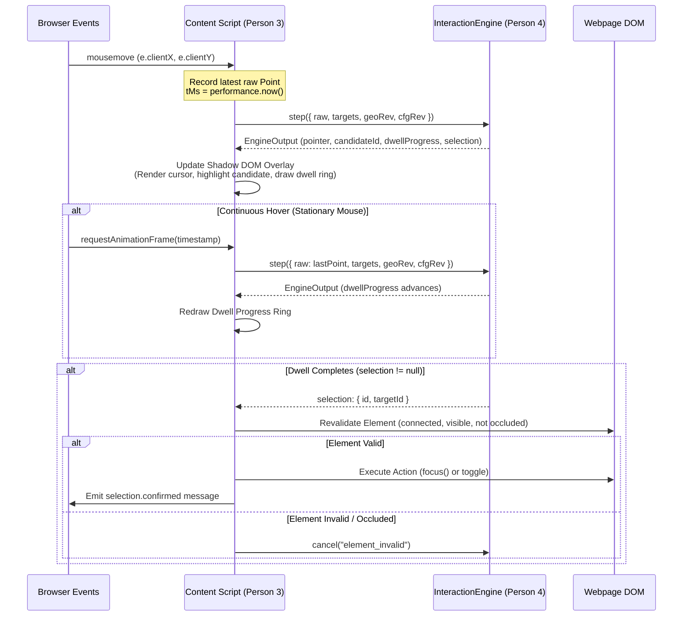

# Public API and Extension Integration Plan (`packages/engine/plans/public-api-and-integration.md`)

**Owner:** Person 4 (Dedeepya)  
**Consumer:** Person 3 (Chrome Extension Content Script)  
**Status:** Planned / Architecture Phase  

---

## 1. Purpose and Ownership

This document specifies the exact public API boundary between the pure mathematical pointer interaction engine (`packages/engine`) and the browser runtime environment (`apps/extension/src/content/`). 

### Ownership Division
- **Person 4 (Dedeepya):** Pure algorithm library. Consumes normalized CSS coordinates, monotonic time, and bounding boxes; returns filtered positions, candidate IDs, ambiguity status, dwell progress, and selection events.
- **Person 3:** Chrome runtime integration. Observes browser DOM events (`mousemove`, `scroll`, `resize`), queries element bounding boxes via `getBoundingClientRect()`, maintains the Shadow DOM virtual cursor overlay, revalidates target viability, and executes DOM actions (`element.focus()`, native click dispatch).

---

## 2. Current Repository State

- `docs/contracts.md` specifies the canonical TypeScript contract for `InteractionEngine`.
- No consumer code exists in `apps/extension/` yet.
- Scaffolding exists in `packages/engine/src/`.

---

## 3. Proposed Public API Specification

Exported from `@steadyhand/engine`:

```typescript
export interface InteractionEngine {
  /**
   * Advances the engine state by one discrete step.
   * Called on every pointer event AND on requestAnimationFrame during stationary dwell.
   */
  step(input: EngineInput): EngineOutput;

  /**
   * Immediately aborts any in-progress dwell and resets candidate tracking.
   * Called by Person 3 on Escape key, window blur, or DOM re-layout.
   */
  cancel(reason: string): void;

  /**
   * Hard-resets filter states and state machines to a specified coordinate.
   * Called by Person 3 on extension re-enable or pointer teleportation.
   */
  reset(point: Point): void;

  /**
   * Atomically applies a new assistance configuration revision.
   * Automatically resets dwell and filter state.
   */
  applyConfig(config: AssistanceConfig): void;
}

export function createInteractionEngine(config: AssistanceConfig): InteractionEngine;
```

---

## 4. Integration Protocol with Person 3

### Step-by-Step Runtime Loop


### Stationary Dwell Stepping Pattern
Because mouse hardware emits events only when physically moving, Person 3 must use a `requestAnimationFrame` loop to step the engine while the pointer is stationary:
```typescript
let lastRawPoint: Point = { x: 0, y: 0, tMs: performance.now() };

function onAnimationFrame(now: number) {
  if (assistanceActive) {
    const input: EngineInput = {
      raw: { x: lastRawPoint.x, y: lastRawPoint.y, tMs: now },
      targets: currentTargetSnapshots,
      geometryRevision: currentGeometryRevision,
      configRevision: currentConfigRevision,
    };
    const output = engine.step(input);
    renderOverlay(output);
    handleSelection(output.selection);
  }
  requestAnimationFrame(onAnimationFrame);
}
```

### Target Revalidation Rule for Person 3
The engine's `selection` output is an algorithmic recommendation, **not** an authorization to bypass browser security. Person 3 MUST perform physical DOM validation before executing any action:
1. Verify `document.contains(element)`.
2. Verify element bounding box has not moved significantly ($|\Delta x| < 4\text{ px}, |\Delta y| < 4\text{ px}$).
3. Verify element is not occluded by a modal or floating banner:
   ```typescript
   const hit = document.elementFromPoint(output.pointer.x, output.pointer.y);
   const isTargetOrDescendant = element.contains(hit) || hit?.contains(element);
   if (!isTargetOrDescendant) {
     engine.cancel("target_occluded");
     return;
   }
   ```
4. Perform native semantic activation:
   - For `kind === 'focus'`: `(element as HTMLElement).focus()`.
   - For `kind === 'toggle'`: `(element as HTMLInputElement).click()`.

---

## 5. Implementation Sequence

1. **Phase 1 (Hour 1):** Define `types.ts` and `InteractionEngine` interface in `packages/engine/src/`.
2. **Phase 2 (Hour 2):** Implement `createInteractionEngine` factory in `packages/engine/src/engine.ts`.
3. **Phase 3 (Hour 3):** Provide mock integration harness in `tests/engine/integration.test.ts` simulating Person 3's event loop.
4. **Phase 4 (Hour 4):** Verify handoff with Person 3 against fixture HTML pages.

---

## 6. Failure Handling

- **DOM Layout Shift / Scroll:** Person 3 increments `geometryRevision`. On the next `step()`, the engine detects the revision change and aborts any active dwell.
- **Escape Key Pressed:** Person 3 calls `engine.cancel("escape_key")`. Dwell progress immediately drops to 0.0.
- **Tab Hidden (`document.visibilityState === 'hidden'`):** Person 3 calls `engine.cancel("tab_hidden")`.
- **Extension Disabled / Uninstalled:** Person 3 calls `engine.reset(zeroPoint)` and destroys the overlay.

---

## 7. Acceptance Criteria

- **Zero-Dependency Check:** Running `npm ls` or inspection of `packages/engine` reveals zero imports of `chrome.*`, `document`, or `window`.
- **Deterministic Stepping:** Stepping with identical input arrays yields identical output structures.
- **Non-Interference:** The engine never calls `preventDefault()` or `stopPropagation()` on native browser events.

---

## 8. Team Handoff

- **Receiver:** Person 3.
- **Contract:** Package `@steadyhand/engine` exported via `package.json`.
- **Handoff Verification Test:** Person 3 imports the engine in a minimal script, passes 10 points, and verifies that `output.pointer` and `output.dwellProgress` update smoothly.

---

## 9. Copy-Ready Implementation Prompt

```text
You are Person 4 (Dedeepya) implementing the public API and engine coordinator for SteadyHand.

Read packages/engine/plans/public-api-and-integration.md and docs/contracts.md.

ALLOWED EDITS:
- packages/engine/src/**
- tests/engine/**

TASK:
1. Implement packages/engine/src/engine.ts (createInteractionEngine and InteractionEngineImpl).
2. Wire up:
   - Filter selection based on AssistanceConfig.
   - TargetArbitrator for candidate selection and ambiguity.
   - DwellStateMachine for monotonic timer accumulation.
3. Implement cancel(), reset(), and applyConfig() with atomic state updates.
4. Export createInteractionEngine and types in packages/engine/src/index.ts.
5. Create tests/engine/integration.test.ts simulating a 60 FPS pointer loop with stationary dwell progression.

Ensure zero external runtime dependencies.
```
