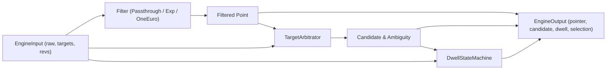

# Pointer Engine Source Architecture (`packages/engine/src/PLAN.md`)

**Owner:** Person 4 (Dedeepya)  
**Directory:** `packages/engine/src/`  
**Status:** Planned / Architecture Phase  

---

## 1. Purpose and Ownership

This directory houses the pure TypeScript source code for the SteadyHand interaction engine. It encapsulates algorithms for signal filtering, target arbitration, and dwell timing into an easily consumable facade interface (`InteractionEngine`).

### Boundaries
- No browser globals (`window`, `document`, `navigator`, `localStorage`, `chrome`).
- No DOM element references (`HTMLElement`, `Event`, `MouseEvent`).
- No React or JSX dependencies.
- No asynchronous networking or web workers.

---

## 2. Current Repository State

- `packages/engine/src/` contains three empty scaffold subdirectories:
  - `filters/`
  - `targeting/`
  - `dwell/`
- No source files currently exist.

---

## 3. Proposed File Structure

```text
packages/engine/src/
├── PLAN.md                                    # This document
├── index.ts                                   # Public package barrel export
├── types.ts                                   # Domain models and contract interfaces
├── engine.ts                                  # InteractionEngineImpl coordinator class
├── filters/
│   ├── PLAN.md                                # Filtering module plan
│   ├── types.ts                               # IPointerFilter interface & FilterConfig
│   ├── passthrough.ts                         # PassthroughFilter (raw_virtual mode)
│   ├── exponential.ts                         # ExponentialFilter implementation
│   └── one_euro.ts                            # OneEuroFilter implementation
├── targeting/
│   ├── PLAN.md                                # Targeting module plan
│   ├── types.ts                               # Target candidate models & geometry types
│   ├── distance.ts                            # Distance calculation helpers (point-to-rect)
│   └── arbitrator.ts                          # TargetArbitrator implementation
└── dwell/
    ├── PLAN.md                                # Dwell module plan
    ├── types.ts                               # DwellState, DwellTransition, DwellConfig
    └── state_machine.ts                       # DwellStateMachine implementation
```

---

## 4. Interfaces and Data

### Internal Module Data Flow


### Module Responsibilities

1. **`filters/`**:
   - Consumes raw `Point(x, y, tMs)`.
   - Produces filtered `Point(x, y, tMs)`.
   - Maintains previous state $(x_{prev}, y_{prev}, t_{prev})$ and derivative state $(\dot{x}_{prev}, \dot{y}_{prev})$.
2. **`targeting/`**:
   - Consumes filtered `Point` and `readonly Target[]`.
   - Computes Euclidean distance from the filtered point to the boundary of each target rectangle.
   - Applies `capture_radius_px`, hysteresis margin (+6 px on exit), and checks `ambiguity_margin_px`.
   - Produces `candidateId: string | null` and `ambiguous: boolean`.
3. **`dwell/`**:
   - Consumes current `candidateId`, `target` eligibility (`dwellAllowed`), and `tMs`.
   - Evaluates state machine transitions: `Idle` $\rightarrow$ `CandidateAcquired` $\rightarrow$ `Dwelling` $\rightarrow$ `Activated` $\rightarrow$ `RearmPending`.
   - Computes normalized progress $0.0 \le \text{progress} \le 1.0$.
   - Generates at-most-once selection object `{ id, targetId }`.
4. **`engine.ts`**:
   - Instantiates filters, arbitrator, and dwell state machine.
   - Exposes public `InteractionEngine` facade methods: `step()`, `cancel()`, `reset()`, `applyConfig()`.

---

## 5. Implementation Sequence

1. **Phase 1: Domain Types (`src/types.ts`)**:
   - Declare all pure types matching `docs/contracts.md`.
2. **Phase 2: Submodules (`src/filters/`, `src/targeting/`, `src/dwell/`)**:
   - Implement filters (`exponential.ts`, `passthrough.ts`).
   - Implement geometry calculations (`distance.ts`, `arbitrator.ts`).
   - Implement dwell transitions (`state_machine.ts`).
3. **Phase 3: Engine Coordinator (`src/engine.ts`)**:
   - Wire submodules together with error handling and revision checking.
4. **Phase 4: Barrel Exports (`src/index.ts`)**:
   - Export public interfaces and classes cleanly.

---

## 6. Failure Handling

- **Submodule Isolation:** If targeting throws due to corrupted target bounding rects (e.g. negative width/height), the engine catches the error, sets `candidateId = null`, logs an internal error, and continues delivering filtered pointer coordinates.
- **Revision Mismatches:** If `geometryRevision` or `configRevision` increments, the engine immediately calls `dwellStateMachine.cancel("revision_changed")` and resets the active target candidate.
- **Zero-Duration Steps:** If `step()` is called multiple times with identical timestamps, the filter bypasses velocity calculation to prevent divide-by-zero errors.

---

## 7. Acceptance Criteria

- All internal source files compile cleanly under strict TypeScript settings (`noImplicitAny`, `strictNullChecks`, `exactOptionalPropertyTypes`).
- No cyclic dependencies between submodules (`filters` does not import `dwell`, `targeting` does not import `engine`).
- Memory footprint remains constant across 10,000 steps (no object leaks).

---

## 8. Team Handoff

- **Receiver:** Person 3.
- **Artifact:** Single importable entry point:
  ```typescript
  import { createInteractionEngine, InteractionEngine, AssistanceConfig } from '@steadyhand/engine';
  ```

---

## 9. Copy-Ready Implementation Prompt

```text
You are Person 4 (Dedeepya) implementing packages/engine/src/ for SteadyHand.

Read packages/engine/src/PLAN.md and the module plans in src/filters/PLAN.md, src/targeting/PLAN.md, and src/dwell/PLAN.md.

TASK:
1. Implement packages/engine/src/types.ts with pure data contracts.
2. Implement packages/engine/src/filters/ (exponential.ts, passthrough.ts).
3. Implement packages/engine/src/targeting/ (distance.ts, arbitrator.ts).
4. Implement packages/engine/src/dwell/ (state_machine.ts).
5. Implement packages/engine/src/engine.ts (InteractionEngineImpl) coordinating the modules.
6. Implement packages/engine/src/index.ts exporting public APIs.

Acceptance: The engine compiles with zero external runtime dependencies and passes all unit tests. Report all exports.
```
