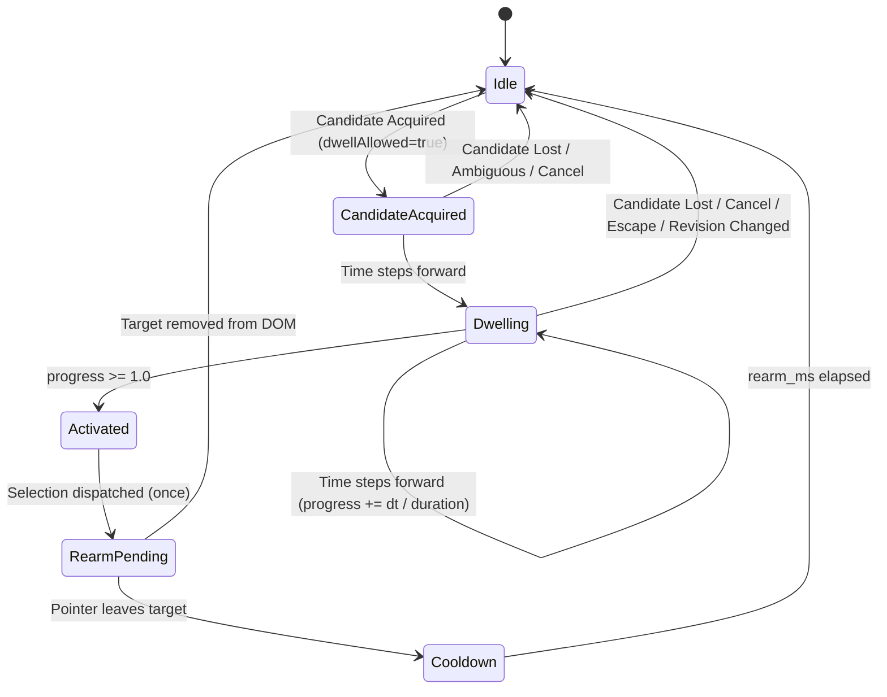

# Dwell State Machine Plan (`packages/engine/src/dwell/PLAN.md`)

**Owner:** Person 4 (Dedeepya)  
**Directory:** `packages/engine/src/dwell/`  
**Status:** Planned / Architecture Phase  

---

## 1. Purpose and Ownership

This module implements the cancellable dwell state machine. It allows users who cannot easily perform physical mouse clicks to trigger actions (such as focusing an input field or toggling a checkbox) simply by resting the pointer over an eligible target for a configured duration.

### Invariants
1. **At-Most-Once Selection:** A continuous hover over a target fires at most one selection event. It will never fire a second time unless the user leaves the target boundary and a rearming cooldown elapses.
2. **Explicit Cancellation:** Moving away, pressing Escape, layout changes (`geometryRevision` bump), or configuration updates instantly cancel dwell and reset progress to 0.0.
3. **Stationary Progress:** Dwell progress advances based on monotonic time increments ($\Delta t$), allowing dwell to complete even if the mouse hardware stops transmitting movement events.
4. **Action Policy:** Only targets with `dwellAllowed === true` can enter `Dwelling` state.

---

## 2. Current Repository State

- `packages/engine/src/dwell/` exists as an empty directory scaffold.
- No dwell source code currently exists.

---

## 3. Proposed File Structure

```text
packages/engine/src/dwell/
├── PLAN.md                                    # This plan
├── types.ts                                   # DwellState enum, DwellTransition, DwellConfig
└── state_machine.ts                           # DwellStateMachine implementation
```

---

## 4. Interfaces and State Transition Diagram

### State Definitions
- `Idle`: Pointer is not over any eligible target. Progress = 0.0.
- `CandidateAcquired`: Target acquired, but dwell delay/tolerance check initializing.
- `Dwelling`: Pointer remains within target capture boundary. Dwell timer actively accumulating ($0.0 < \text{progress} < 1.0$).
- `Activated`: Dwell duration reached ($1.0$). Dispatches exactly one `SelectionEvent`.
- `RearmPending`: Pointer remains over activated target. Further activations blocked.
- `Cooldown`: Target exited; waiting for `rearm_ms` before allowing re-acquisition of the same target.

### State Transition Diagram


### Transition Matrix

| Current State | Event | Next State | Action / Output |
| :--- | :--- | :--- | :--- |
| `Idle` | Candidate acquired & eligible | `CandidateAcquired` | `progress = 0.0`, `dwellStartTime = tMs` |
| `CandidateAcquired` | Time advances | `Dwelling` | `progress = dt / duration_ms` |
| `Dwelling` | Time advances ($t < t_{start} + duration$) | `Dwelling` | `progress = min(1.0, (tMs - t_{start}) / duration)` |
| `Dwelling` | Time advances ($t \ge t_{start} + duration$) | `Activated` | `progress = 1.0`, Emit `SelectionEvent` |
| `Dwelling` | Candidate lost (user moved away) | `Idle` | `progress = 0.0` |
| `Dwelling` | `cancel(reason)` or revision change | `Idle` | `progress = 0.0`, active target cleared |
| `Activated` | Immediate transition | `RearmPending` | Target locked in rearm set |
| `RearmPending` | Pointer leaves target | `Cooldown` | Cooldown timer starts (`rearm_ms`) |
| `Cooldown` | `rearm_ms` elapsed | `Idle` | Target cleared from lock set |

---

## 5. Implementation Sequence

### Stage 1: State Machine Implementation (`state_machine.ts`)
1. Define states and interfaces in `src/dwell/types.ts`.
2. Implement `DwellStateMachine` class with explicit transition methods:
   - `step(candidateId, dwellAllowed, tMs): { progress, selection }`
   - `cancel(reason): void`
   - `reset(): void`
3. Generate unique UUID/string IDs for selection events: `selection-${timestamp}-${counter}`.

### Stage 2: Invariant Testing
1. Test stationary repeated steps advancing progress.
2. Test at-most-once selection dispatch during continuous hover of $10\text{ seconds}$.
3. Test leave-to-rearm cycle.
4. Test instantaneous cancellation on geometry revision update.

---

## 6. Failure Handling

- **Time Jumps ($\Delta t > 1000\text{ ms}$):** If time leaps forward due to CPU sleep or background tab suspension, cap $\Delta t$ and cancel dwell rather than triggering an instantaneous accidental activation.
- **Clock Reversal ($\Delta t < 0$):** Retain current progress without decrementing; log warning.
- **Target Removal During Dwell:** If candidate disappears from DOM, reset immediately to `Idle`.

---

## 7. Acceptance Criteria

- **Single Activation:** A hover lasting $5\text{ seconds}$ on an $800\text{ ms}$ dwell target generates exactly one selection event on the step where $t \ge 800\text{ ms}$, and zero selection events on all subsequent steps.
- **Cancellation Speed:** Calling `cancel("user_escaped")` resets progress to $0.0$ in the same tick.
- **Ineligible Target:** Hovering over a target with `dwellAllowed = false` leaves progress at $0.0$ and generates no selection events.

---

## 8. Team Handoff

- **Receiver:** `packages/engine/src/engine.ts`.
- **Artifact:** `DwellStateMachine` class.
- **Consumer Verification:** Content script can step dwell on `requestAnimationFrame` even when mouse is stationary.

---

## 9. Copy-Ready Implementation Prompt

```text
You are Person 4 (Dedeepya) implementing the dwell state machine for SteadyHand.

Read packages/engine/src/dwell/PLAN.md and docs/contracts.md.

ALLOWED EDITS:
- packages/engine/src/dwell/**
- tests/engine/**

TASK:
1. Implement packages/engine/src/dwell/types.ts declaring DwellState, DwellConfig, and SelectionEvent.
2. Implement packages/engine/src/dwell/state_machine.ts with states:
   Idle, CandidateAcquired, Dwelling, Activated, RearmPending, Cooldown.
3. Enforce the invariants:
   - Monotonic time progress calculation.
   - At-most-once selection dispatch per continuous hover.
   - Leave-to-rearm transition before candidate can fire again.
   - Instant cancellation on cancel() or geometry/config revision mismatch.
4. Implement unit tests in tests/engine/ checking:
   - Progress increments with monotonic dt.
   - Exactly one selection event emitted.
   - Rearm required before second activation.
   - Cancel clears progress to 0.0 immediately.

Verify all tests pass.
```
