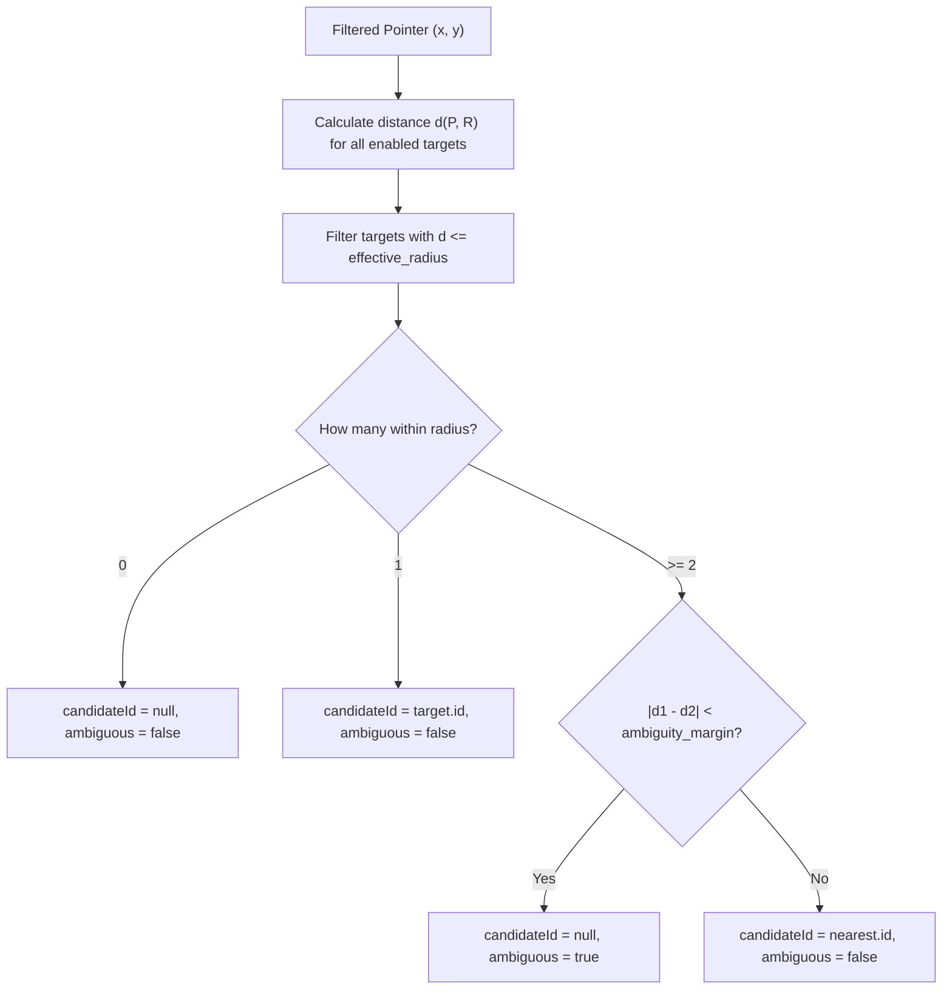

# Target Acquisition Module Plan (`packages/engine/src/targeting/PLAN.md`)

**Owner:** Person 4 (Dedeepya)  
**Directory:** `packages/engine/src/targeting/`  
**Status:** Planned / Architecture Phase  

---

## 1. Purpose and Ownership

This module arbitrates candidate UI targets on supported webpages. Given the filtered virtual pointer position and an array of candidate rectangles from the browser, it selects the single best target candidate while rejecting ambiguous overlaps and preventing jittery boundary oscillations.

### Boundaries
- Pure computational geometry.
- Consumes plain coordinate rectangles (`Rect: { x, y, width, height }`).
- Does NOT query the DOM, calculate element styles, or inspect visibility (Person 3 provides validated rectangles).

---

## 2. Current Repository State

- `packages/engine/src/targeting/` exists as an empty directory scaffold.
- No targeting source code currently exists.

---

## 3. Proposed File Structure

```text
packages/engine/src/targeting/
├── PLAN.md                                    # This plan
├── types.ts                                   # Candidate, TargetDistance, TargetingConfig
├── distance.ts                                # Point-to-rectangle boundary Euclidean distance
└── arbitrator.ts                              # TargetArbitrator implementation
```

---

## 4. Interfaces and Mathematical Formulations

### Geometric Distance to Axis-Aligned Rectangle
For pointer $P = (x, y)$ and target rectangle $R$ with $[R_{left}, R_{right}]$ and $[R_{top}, R_{bottom}]$:
1. Clamp point to rectangle:
   $$x_{clamped} = \max(R_{left}, \min(x, R_{right}))$$
   $$y_{clamped} = \max(R_{top}, \min(y, R_{bottom}))$$
2. Distance $d(P, R)$:
   $$d(P, R) = \sqrt{(x - x_{clamped})^2 + (y - y_{clamped})^2}$$
   - If pointer is inside $R$, $d(P, R) = 0.0$.
   - If pointer is outside, $d(P, R)$ is the shortest Euclidean distance to the nearest edge or corner.

### Candidate Selection Rules



### Hysteresis (Anti-Flicker)
To prevent the cursor from rapidly dropping and re-acquiring a candidate when hovering near its boundary:
- **Enter Threshold:** $R_{enter} = \text{capture\_radius\_px}$ (default 16 px).
- **Exit Threshold:** $R_{exit} = \text{capture\_radius\_px} + 6\text{ px}$.
- If target $T$ is already the active candidate, it remains the candidate as long as $d(P, T) \le R_{exit}$, unless another target is significantly closer.

### Ambiguity Margin
- If two targets $T_1, T_2$ both satisfy the capture radius, and $|d(P, T_1) - d(P, T_2)| < \text{ambiguity\_margin\_px}$ (default 8 px):
  - Mark `ambiguous = true`.
  - Set `candidateId = null`.
  - Halt dwell timers to prevent accidental activation of the wrong control.

### Deliberate Escape Motion
- If pointer speed exceeds $600\text{ px/s}$ directed away from the active target, the hysteresis margin is immediately set to $0\text{ px}$, allowing smooth, frictionless departure.

---

## 5. Implementation Sequence

### Stage 1: Geometry & Distance (`distance.ts`)
1. Implement boundary clamping and Euclidean distance calculations in `distance.ts`.
2. Verify corners, edges, and internal points against unit test vectors.

### Stage 2: Arbitration Logic (`arbitrator.ts`)
1. Implement `TargetArbitrator` class with state tracking for current candidate.
2. Implement ambiguity rejection and hysteresis thresholding.
3. Add tie-breaking rules: if distances are identical, prefer currently active candidate; if none active, prefer smaller area (finer control).

---

## 6. Failure Handling

- **Zero-Size Targets ($width \le 0$ or $height \le 0$):** Exclude from candidate evaluation.
- **Negative or Infinite Coordinates:** Filter out nonfinite target rectangles.
- **Target Disappearance:** If active candidate ID is no longer present in `targets` array, immediately clear candidate and hysteresis.

---

## 7. Acceptance Criteria

- **Inside Rectangle:** Pointer inside target produces $d = 0.0$ and acquires candidate.
- **Hysteresis Stability:** A pointer oscillating across the capture boundary ($\pm 2\text{ px}$) does not repeatedly acquire and drop the candidate.
- **Ambiguity Safety:** Two adjacent checkboxes 4 px apart with cursor equidistant between them produce `ambiguous = true` and `candidateId = null`.
- **Performance:** Computes candidate selection for 100 targets in $<0.15\text{ ms}$.

---

## 8. Team Handoff

- **Receiver:** `packages/engine/src/engine.ts`.
- **Artifact:** `TargetArbitrator` class.
- **Consumer Verification:** Engine passes targets and filtered point to arbitrator each step.

---

## 9. Copy-Ready Implementation Prompt

```text
You are Person 4 (Dedeepya) implementing target acquisition and arbitration for SteadyHand.

Read packages/engine/src/targeting/PLAN.md and docs/contracts.md.

ALLOWED EDITS:
- packages/engine/src/targeting/**
- tests/engine/**

TASK:
1. Implement packages/engine/src/targeting/types.ts declaring CandidateResult, TargetWithDistance, and TargetingConfig.
2. Implement packages/engine/src/targeting/distance.ts computing shortest Euclidean distance from a 2D point to an axis-aligned rectangle boundary.
3. Implement packages/engine/src/targeting/arbitrator.ts with:
   - Capture radius filtering.
   - Hysteresis (enter radius vs exit radius = enter + 6px).
   - Ambiguity rejection (|d1 - d2| < ambiguity_margin).
   - Tie-breaking (active candidate preference, then smaller area).
   - Deliberate escape handling.
4. Implement unit tests in tests/engine/ checking:
   - Clamping and boundary distance for corners, edges, interior.
   - Ambiguity triggered on adjacent targets.
   - Hysteresis prevents rapid cycling.
   - Target removal clears candidate immediately.

Verify that all tests pass.
```
